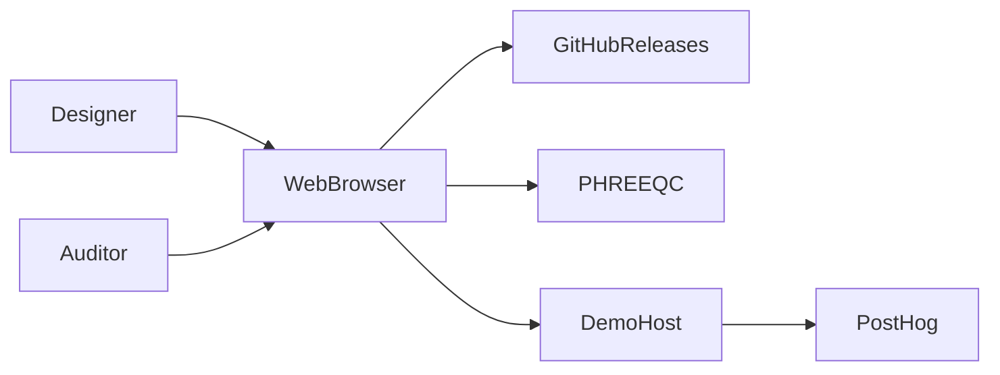

# 3. Context and scope

What Amanzi is in its environment: people, external systems, in and out of scope. The canonical drawing is [c4-context](c4/context.md). The diagram below is a summary and uses the same node IDs.

## In scope

- Flowsheet editor: Vue components under `ui/src/components/` and per-unit blocks under `ui/src/models/`.
- Project JSON: `ui/src/stores/project.js` and `amanzi/core/project.py` ([adr-0001](decisions/0001-json-project-as-system-of-record.md)).
- Solvers: `amanzi/components/solvers/` ([bb-solvers](building-blocks/solvers.md)).
- Process unit models: `amanzi/models/` ([bb-process-models](building-blocks/process-models.md)).
- Reports and design views: `AmanziAPI.report` and `AmanziAPI.design` (`amanzi/server/api.py`); UI dialogs in `ui/src/App.vue`.
- Calculation either in the browser (`ui/src/backend/python.worker.js`) or over HTTP (`amanzi/server/app.py`, `lambda/lambda_function.py`).

## Out of scope

- SCADA, laboratory LIMS, and GIS. None of these appear as integrations under `amanzi/` or `ui/src/`.
- Excel import. No spreadsheet importer runs. `amanzi/models/marblefiltration.py` has commented `openpyxl` and `xlsxwriter` imports; they are not used.
- A contributor tutorial for adding a process unit. That procedure stays in the code and in `README.md`, not on this site.

## Actors

- `Designer` — the person who draws scenarios in the GUI (`ui/`).
- `Auditor` — a person reading results and this site. The node `auditorActor` in [c4-context](c4/context.md) is that reader. They are a runtime actor only if they open the app.
- AI agents are readers of `architecture/`. They are not a runtime component.

## External systems

| Node | What it is | Where it is named |
| --- | --- | --- |
| `WebBrowser` | Host of the SPA and, in the Pyodide deployment, of the worker | `ui/` |
| `GitHubReleases` | UI zip attached to a tag | `.github/workflows/deploy-ui.yml` |
| `PHREEQC` | Chemistry library via PhreeqPython | `pyproject.toml`, `amanzi/core/scenario.py` |
| `DemoHost` | Whatever serves `https://demo.amanzi.app` | `README.md`. Operator **TBD** |
| `PostHog` | Analytics from the production bundle | `ui/src/plugins/posthog.js` |
| API Gateway + Lambda | Optional HTTP API | `lambda/lambda_function.py`, `lambda/README.md` |

## Diagrams

