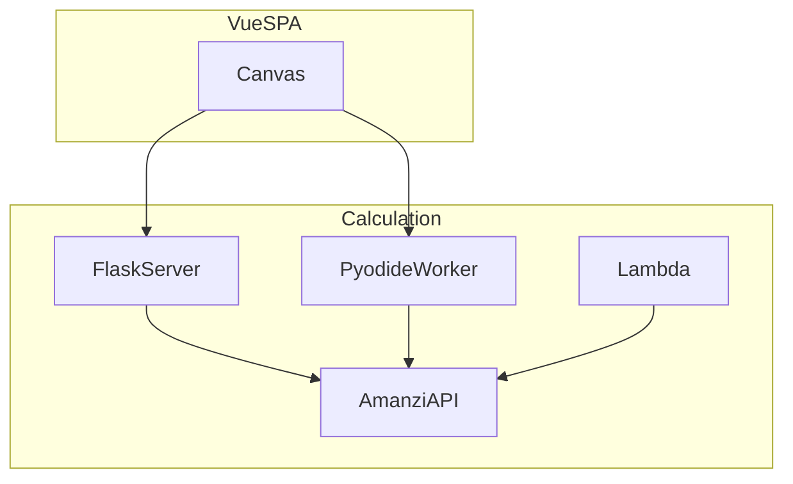

# 5. Building block view

Static decomposition. Level 1 is the system in context. Level 2 is containers. Level 3 is named components. Canonical drawings: [c4-context](c4/context.md), [c4-containers](c4/containers.md), [c4-components](c4/components.md).

## Level 1

Amanzi is one system (`AmanziSystem`) used by a designer, reading PHREEQC, shipping from GitHub releases, and optionally talking to a demo host and PostHog. See [arc42-03](03-context-and-scope.md).

## Level 2

One SPA, one active calculation container per session, and the data files that container reads.

| Container | Path | Page |
| --- | --- | --- |
| `VueSPA` | `ui/` | [bb-vue-spa](building-blocks/vue-spa.md) |
| `PyodideWorker` | `ui/src/backend/python.worker.js` | [bb-pyodide-worker](building-blocks/pyodide-worker.md) |
| `FlaskServer` | `amanzi/server/app.py` | [bb-flask-server](building-blocks/flask-server.md) |
| `Lambda` | `lambda/lambda_function.py` | [bb-lambda](building-blocks/lambda.md) |
| `ProjectJSON` | browser `localStorage` and the user’s file | [bb-project-scenario](building-blocks/project-scenario.md) |
| `ParametricYAML` | `amanzi/parametric/` | [bb-parametric-yaml](building-blocks/parametric-yaml.md) |
| `CsvDatabases` | `amanzi/database/`, `amanzi/models/membranestack/membrane_database.csv` | [c4-containers](c4/containers.md) |

Only one of `PyodideWorker`, `FlaskServer`, or `Lambda` is the calculation host for a session ([adr-0002](decisions/0002-dual-execution-backends.md)).

## Level 3

| id | Path |
| --- | --- |
| [bb-amanzi-api](building-blocks/amanzi-api.md) | `amanzi/server/api.py` |
| [bb-project-scenario](building-blocks/project-scenario.md) | `amanzi/core/project.py`, `amanzi/core/scenario.py`, `amanzi/core/database.py` |
| [bb-solvers](building-blocks/solvers.md) | `amanzi/components/solvers/` |
| [bb-process-models](building-blocks/process-models.md) | `amanzi/models/` |
| [bb-parametric-yaml](building-blocks/parametric-yaml.md) | `amanzi/parametric/`, `amanzi/models/parametric/` |
| [bb-vue-spa](building-blocks/vue-spa.md) | `ui/` |
| [bb-pyodide-worker](building-blocks/pyodide-worker.md) | `ui/src/backend/python.worker.js` |
| [bb-flask-server](building-blocks/flask-server.md) | `amanzi/server/app.py` |
| [bb-lambda](building-blocks/lambda.md) | `lambda/` |

The SPA does not import Python model classes. It loads Vue blocks from `ui/src/models/` (`ui/src/main.js`) and asks the backend for parameter schemas.

## Diagrams

Container sketch. The canonical container diagram is [c4-containers](c4/containers.md).

