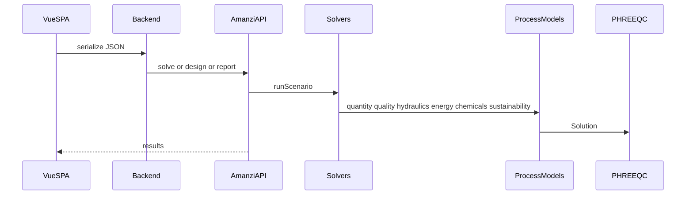

# 6. Runtime view

What happens when a user loads a project and asks for results. Solver order is [adr-0003](decisions/0003-sequential-solvers.md). The façade is [bb-amanzi-api](building-blocks/amanzi-api.md).

## Bootstrap

`ui/src/main.js` chooses the backend:

- `VITE_BACKEND=server` uses `ui/src/backend/server.js` (HTTP). Development sets `VITE_SERVER_URL` to `http://localhost:7331/api` (`ui/.env.development`).
- Any other value uses `ui/src/backend/python.js`, which starts `ui/src/backend/python.worker.js`.

The worker loads Pyodide from the jsDelivr CDN, then installs the PhreeqPython wheel and the Amanzi wheel from `dist/` next to the app, then constructs `amanzi.server.api.AmanziAPI` (`ui/src/backend/python.worker.js`). The release workflow writes those wheels into `ui/public/dist` (`.github/workflows/deploy-ui.yml`).

## Load

`projectStore.open` (`ui/src/stores/project.js`) reads `localStorage` key `project`. If that key is empty it uses the default passed from `ui/src/App.vue`: `ui/src/assets/Default-project-EN.json`, `Default-project-NL.json`, or `Default-project-DE.json`, chosen from the active locale.

Before the store applies the document, `migrateProject` (`ui/src/lib/projectMigration.js`) runs the forward-only log in `ui/src/lib/migrationConfig.js`. If a migration ran, `ui/src/App.vue` calls `notifyMigrationIfNeeded` (`ui/src/lib/migrationToast.js`), which shows an Element Plus notification.

## Validate

`solveDebounced` in `ui/src/stores/project.js` calls `scenario.validate()` (`ui/src/stores/scenario.js`) before any backend call. Validation requires at least one model whose block spec has `source: true` and one with `sink: true`, and a connection on every anchor that is not `optional`. Failure sets `interfaceStore.invalid` and does not call the backend.

## Solve, design, or report

The same debounced function (200 ms, trailing) picks one call (`ui/src/stores/project.js`):

- Report dialog open → `backend.report(serialize())`.
- A unit’s design view open (`scenario.editingModel`) → `backend.design(serialize(), scenarioIndex, modelUid)`.
- Otherwise → `backend.solve(serialize(), scenarioIndex)`.

On the Python side (`amanzi/server/api.py`):

- `solve` builds a `Project`, runs `run_scenario()` on that scenario, and returns connection flows, hydraulics, and metric summaries.
- `design` runs `run_scenario(until=model)` and then `run_design()` on that model.
- `report` builds a `Project` and returns `Project.report()`, which solves every scenario (`amanzi/core/project.py`).

## Solver chain

`Scenario.run_scenario` walks an `OrderedDict`: quantity, quality, hydraulics, energy, chemicals, sustainability (`amanzi/core/scenario.py`). Each solver’s `solve` lives under `amanzi/components/solvers/`.

Quality walks stream types `product`, then `flush`, then `waste`, and repeats until convergence or 100 iterations (`amanzi/components/solvers/qualitysolver.py`, `max_iterations = 100`, `precision = 0.0001`). Models call into a PHREEQC `Solution` (`amanzi/components/solution.py` extends `phreeqpython.Solution`). Recycle and emitter handling is inside that solver.

## Failure

- Quality raises `Exception` when the mass balance has not converged after `max_iterations` (`amanzi/components/solvers/qualitysolver.py`).
- A missing key figure raises `KeyError` from `Database.get` (`amanzi/core/database.py`).
- The SPA `catch` sets `ui.invalid = true` and does not copy the Python message into `invalid_message` (`ui/src/stores/project.js`). The banner in `ui/src/App.vue` then translates `invalid_message`, which stays at the previous value or empty. Engine failures therefore surface as a generic invalid state. See [arc42-11](11-risks-and-technical-debt.md).

## Diagrams

