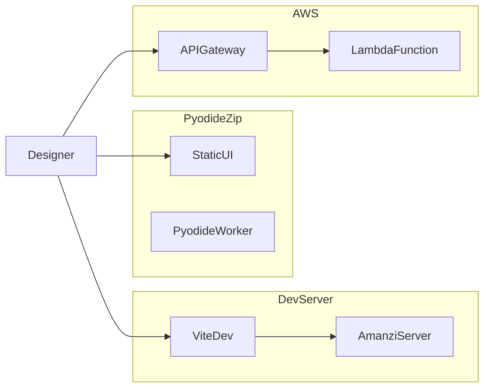

# 7. Deployment view

Where the software runs. Three calculation hosts exist ([adr-0002](decisions/0002-dual-execution-backends.md)). Which one `https://demo.amanzi.app` uses is **TBD** ([arc42-01](01-introduction-and-goals.md)). The GitHub release artifact is the Pyodide zip.

## Pyodide static zip

`.github/workflows/deploy-ui.yml` builds an Amanzi wheel into `ui/public/dist`, downloads the PhreeqPython wheel, writes `VITE_BACKEND=pyodide` and `VITE_AMANZI_WHEEL_FILENAME` into `ui/.env.production.local`, runs `npm run build`, and zips `ui/dist`. On a tag `v*` it uploads `dist.zip` to that GitHub release.

Any static file server can host that zip. The worker then loads Pyodide from the jsDelivr CDN and the two wheels from `dist/` beside the app (`ui/src/backend/python.worker.js`). PHREEQC in this deployment is inside the worker, via the PhreeqPython wheel.

## Flask development server

`amanzi-server` (`pyproject.toml`) runs Flask from `amanzi/server/app.py`. Default port is 7331. `--debug` enables Flask debug. `--no-browser` skips opening a browser. The process serves `ui/dist` as static files and the `/api/*` routes. PHREEQC is in the same Python process (`phreeqpython` from `pyproject.toml`). Local UI development points `VITE_SERVER_URL` at `http://localhost:7331/api` (`ui/.env.development`) and sets `VITE_BACKEND=server` when that mode is wanted (`ui/src/main.js`).

## AWS Lambda

`lambda/lambda_function.py` constructs one `AmanziAPI` and dispatches `parameters`, `solve`, `report`, `design`, `keyfigures`, and `version`. `lambda/Dockerfile` is the image build. `lambda/README.md` holds the build command. That file is operations notes, not a user tutorial. PHREEQC is inside the function image, same library as Flask. API Gateway is the HTTP front (`lambda/README.md`).

## Documentation CI

`.github/workflows/build-docs.yml` builds the user site (`zensical.toml`, `zensical.nl.toml`, `zensical.de.toml`, `zensical.fr.toml`) and this site (`zensical.architecture.toml`), then uploads `docs-html.zip` and `architecture-html.zip`. It does not publish GitHub Pages.

## TBD

Operator of `demo.amanzi.app`, TLS, RTO/RPO, data residency, and which backend that host runs. The URL is named in `README.md`. None of those operational facts are in the workflows above.

## Diagrams

