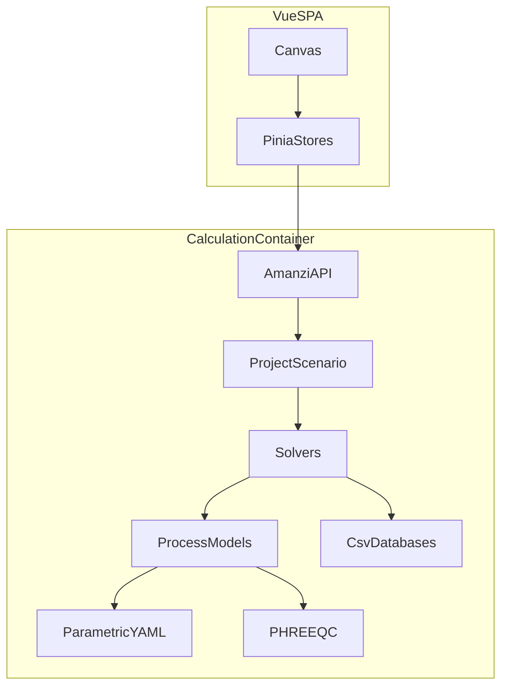

# C4 components

Inside the calculation container and the SPA. Each node maps to a building-block page or a data file.

## Diagram

## Legend

- `Canvas` — flowsheet components under `ui/src/components/`. Per-unit blocks are `ui/src/models/*/block.vue`, registered in `ui/src/main.js`.
- `PiniaStores` — `ui/src/stores/` (`project.js`, `scenario.js`, `interface.js`, `runtime.js`).
- `AmanziAPI` — `amanzi/server/api.py` ([bb-amanzi-api](../building-blocks/amanzi-api.md)).
- `ProjectScenario` — `amanzi/core/` ([bb-project-scenario](../building-blocks/project-scenario.md)).
- `Solvers` — `amanzi/components/solvers/` ([bb-solvers](../building-blocks/solvers.md)).
- `ProcessModels` — `amanzi/models/` ([bb-process-models](../building-blocks/process-models.md)).
- `ParametricYAML` — `amanzi/parametric/` ([bb-parametric-yaml](../building-blocks/parametric-yaml.md)).
- `PHREEQC` — `phreeqpython.Solution`, with extra methods in `amanzi/components/solution.py`.
- `CsvDatabases` — `amanzi/database/`, plus `amanzi/models/membranestack/membrane_database.csv`.

## AmanziAPI methods

Called from the stores (`ui/src/stores/project.js`) and implemented in `amanzi/server/api.py`:

| Method | Role |
| --- | --- |
| `parameters` | JSON schemas of input parameters for every exported `ParametricModel` subclass except `Model`. |
| `keyfigures` | Rows of `amanzi/database/key_figures.csv`. |
| `solve` | Run one scenario; return flows, hydraulics, and metric summaries. |
| `design` | Run until one model uid, then that model’s `run_design`. |
| `report` | Solve every scenario and return summaries. |

Flask exposes those as `/api/...` (`amanzi/server/app.py`). The worker calls the methods in-process (`ui/src/backend/python.worker.js`). Lambda dispatches the same names (`lambda/lambda_function.py`).

The SPA never imports Python model classes. Vue files under `ui/src/models/` are interface components. Parameter fields come from `parameters()`.
