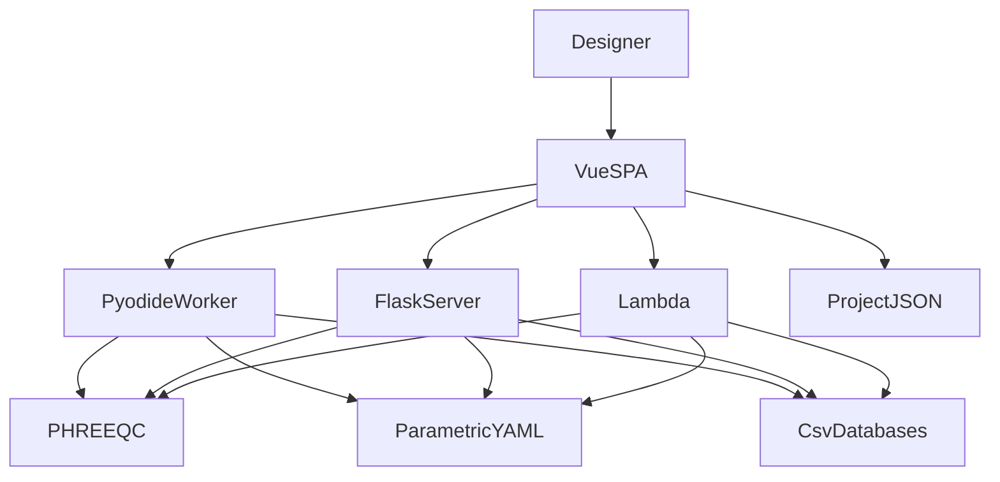

# C4 containers

Runnable and deployable pieces. Only one calculation container is active per session: Pyodide **or** Flask **or** Lambda ([adr-0002](../decisions/0002-dual-execution-backends.md)).

## Diagram

## Legend

- `VueSPA` — `ui/` (Vite, Vue 3, Pinia, Element Plus; `ui/package.json`).
- `PyodideWorker` — `ui/src/backend/python.worker.js`.
- `FlaskServer` — `amanzi/server/app.py` (`amanzi-server`).
- `Lambda` — `lambda/lambda_function.py`.
- `ProjectJSON` — user file or `localStorage` key `project` (`ui/src/stores/project.js`).
- `ParametricYAML` — `amanzi/parametric/`.
- `CsvDatabases` — `amanzi/database/key_figures.csv`, `amanzi/database/pfas_isotherms.csv`, `amanzi/models/membranestack/membrane_database.csv`.
- `PHREEQC` — PhreeqPython `Solution`, extended in `amanzi/components/solution.py`.

## Protocols

| Edge | Protocol |
| --- | --- |
| `VueSPA` → `PyodideWorker` | `postMessage` in the browser (`ui/src/backend/python.js`). Methods: `initialize`, `parameters`, `keyfigures`, `solve`, `design`, `report`. |
| `VueSPA` → `FlaskServer` | HTTP. Base URL is `VITE_SERVER_URL` (`ui/src/backend/server.js`). Development value is `http://localhost:7331/api` (`ui/.env.development`). Routes: `GET /api/parameters`, `GET /api/keyfigures`, `POST /api/solve/<scenario>`, `POST /api/design/<scenario>/<model>`, `POST /api/report` (`amanzi/server/app.py`). |
| `VueSPA` → `Lambda` | Same HTTP shape. The function reads `event['path']` and `event['body']` (`lambda/lambda_function.py`). The SPA still uses `server.js` when `VITE_BACKEND` is `server`. |
| Calculation container → `PHREEQC` | In-process. Each host imports PhreeqPython. The zip deployment carries the wheel; Flask and Lambda use the installed package (`pyproject.toml`). |
| Calculation container → `ParametricYAML` / `CsvDatabases` | Files inside the Python package (`importlib.resources` in `amanzi/models/parametric/parametric.py`; `Path` in `amanzi/core/database.py`). |

`VueSPA` → `ProjectJSON` is local: `localStorage` or a file the user opens (`ui/src/stores/project.js`, `ui/src/components/MenuBar.vue`).
