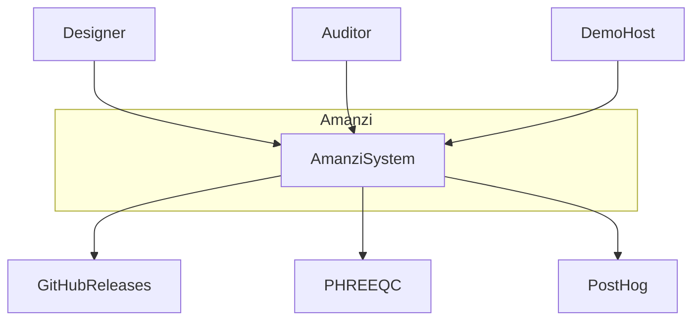

# C4 context

System in its environment. Node IDs are stable for citation. Narrative scope is [arc42-03](../03-context-and-scope.md).

## Diagram

## Legend

- `Designer` — person drawing scenarios in the GUI (`ui/`).
- `Auditor` — person reading results and this architecture site. Not a runtime actor unless they open the app.
- `AmanziSystem` — the product: SPA plus engine (`ui/`, `amanzi/`).
- `GitHubReleases` — UI zip and the wheels inside it (`.github/workflows/deploy-ui.yml`).
- `PHREEQC` — chemistry library via PhreeqPython (`pyproject.toml`, `amanzi/core/scenario.py`).
- `DemoHost` — whoever serves `https://demo.amanzi.app` (`README.md`). Operator **TBD**.
- `PostHog` — production analytics (`ui/src/plugins/posthog.js`). Data classes **TBD**.

## Edges

| Edge | What crosses | Trust note |
| --- | --- | --- |
| `Designer` → `AmanziSystem` | Gestures and a project JSON | The SPA stores that JSON in the browser (`ui/src/stores/project.js`). No account. |
| `Auditor` → `AmanziSystem` | The same, if they open the app. Reading this site does not send a project. | This site is static Markdown. |
| `AmanziSystem` → `GitHubReleases` | The user downloads `dist.zip` | Wheels are built or fetched in CI (`.github/workflows/deploy-ui.yml`). |
| `AmanziSystem` → `PHREEQC` | Solution compositions inside the process | In-process library, not a network service (`amanzi/core/scenario.py`). |
| `DemoHost` → `AmanziSystem` | The host serves the SPA | Whether that host stores scenarios is **TBD**. |
| `AmanziSystem` → `PostHog` | Analytics from the production bundle to `https://eu.i.posthog.com` | Installed only when Vite mode is not `development` (`ui/src/main.js`). Event list **TBD**. |

Trust boundaries that are visible in the repo: the browser (SPA and Pyodide), a machine running Flask, and an AWS account running Lambda ([arc42-07](../07-deployment-view.md)). Which of those `DemoHost` is, is **TBD**.
