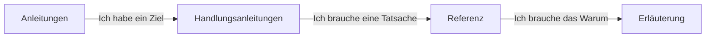

# Amanzi

Amanzi ist ein Entwurfs- und Szenario-Werkzeug für Trinkwasseraufbereitungsanlagen. Sie zeichnen eine Anlage auf einer Zeichenfläche, verbinden Wasserströme, und Amanzi berechnet Menge, Qualität, Energie, Chemikalien und CO₂ für ein oder mehrere Was-wäre-wenn-Entwürfe. Es ist **kein** Live-Anlagensteuerungssystem.

Nutzen Sie die [gehostete Demo](https://demo.amanzi.app), während Sie lernen. Sie müssen keine Laboranalyse erfinden, um zu starten.

## Für wen diese Dokumentation gedacht ist

- **Neu hier** (kein Hintergrund in Software, Verfahrenstechnik oder Wasseraufbereitung): beginnen Sie mit den [Anleitungen](tutorials/index.md). Nutzen Sie das Demo-Projekt. Wenn ein Wort unbekannt wirkt, öffnen Sie die [Erläuterung](explanation/index.md).
- **Schlüsselanwender** (Sie kennen bereits eines dieser Fachgebiete): springen Sie zu den [Handlungsanleitungen](how-to/index.md) für eine Aufgabe, zur [Referenz](reference/index.md) für Parameter und Einheiten und zur [Erläuterung](explanation/index.md) dafür, wie die Modelle funktionieren und welche Literatur sie nutzen.

## Die vier Abschnitte

Das sind unterschiedliche *Arten* von Seiten, nicht vier Schwierigkeitsstufen.

- **Anleitungen** — eine geführte erste Erfahrung mit der Demo-Anlage.
- **Handlungsanleitungen** — Schritte für eine Aufgabe, die Sie bereits erledigen wollen.
- **Referenz** — was ein Bedienelement, ein Strom, eine Einheit oder eine Zahl *ist*.
- **Erläuterung** — wofür Amanzi gedacht ist, was die Wasserkennzahlen bedeuten und die Wissenschaft hinter den Modellen.

## Inhalt zum Schreiben

- Produktbeschreibung in einem Absatz in Alltagssprache (Zeichenfläche, Szenarien, fünf Ergebnisfamilien).
- Zwei Einstiege für Zielgruppen mit den Links oben, kurz gehalten.
- Ehrlichkeitshinweis: Entwurfs-/Szenario-Werkzeug, kein SCADA, kein Ersatz für einen zugelassenen Entwurf.
- Link zur Demo und zu GitHub-Releases.
- Die Vier-Abschnitte-Karte (Mermaid, bereits entworfen).
- Hinweis, dass diese Dokumentation und die App auf Englisch, Niederländisch und Deutsch verfügbar sind (Sprachauswahl). Die Architekturdokumentation bleibt Englisch.
