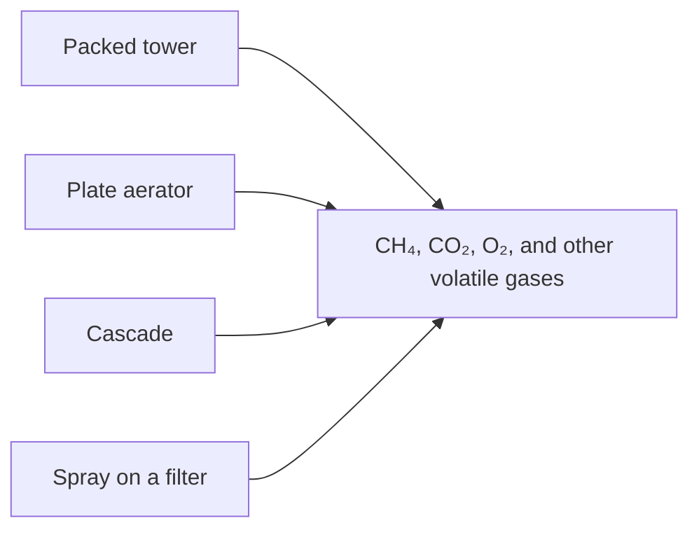

# Aeration

Groundwater arrives short of oxygen and rich in gases that belong in the air: methane, carbon dioxide, and sometimes hydrogen sulfide. Aeration is the contact that moves those gases. Oxygen enters. The others leave, to a degree the geometry decides. The library offers three aerators you can place: a packed tower, a plate aerator, and a cascade. A sand or marble filter can also spray the water onto the bed. The spray block itself is not in the library. Citations are on [Literature](literature.md). Fields are in the [process-unit reference](../reference/process-units/index.md).

## Packed tower

Water falls through packing while air is blown up. The mass-transfer coefficient follows Onda’s correlation: gas-side and liquid-side coefficients, a wetted area, and a height of a transfer unit. Tower height over that HTU gives the number of transfer units, and from that the removal of each compound. Henry’s constant and the diffusivities come from the coefficients stored for each gas. The air–water ratio and the inlet gas concentration close the balance. For CO₂ the inlet air is given a small carbon-dioxide content. For the other gases it is taken as clean.

The hydraulics of the packing follow Engel and Stichlmair: static holdup, dynamic holdup, pressure drop, and a flooding line. The blower power is an isentropic compression from atmospheric pressure across that pressure drop, divided by the blower efficiency. The packing names in the model are the Raflux sizes. The design view draws the operating point against the flooding curve so a diameter that floods is visible as a flooded column rather than as a silent efficiency.

A tower is the aerator to choose when the gas must actually be stripped, including volatile compounds that a short cascade will barely touch. It is also the aerator with a blower to power and a flooding limit to respect.

## Plate

A plate aerator mixes the water with a gas phase in PHREEQC’s `interact`. The gas is the air ratio you set. With no recirculation that contact happens once. With recirculation of off-gas the contact is repeated a few times, and the fresh-air volume is the air ratio minus the off-gas that was sent back. It is a practical plate, not a packed-column correlation. Use it when the train needs a first contact with air, as the demo does at **Plaatbeluchting**, and the deep methane removal can wait for a tower later.

## Cascade

A cascade is a stack of steps. For oxygen and carbon dioxide the efficiency per step is an empirical function of the logarithm of the step height. For methane the efficiency is a polynomial in step height, and the saturation concentration is interpolated at 10 °C from Duan and Mao’s solubility table. The change in concentration over the whole cascade is

ΔC = (Csat − Cin) · (1 − (1 − k)^steps).

The design view repeats that for one to eight steps so you can see pH, CO₂, oxygen, and methane move with step count. A cascade is the simple outdoor aerator: no blower, a modest effect on methane, a clear effect on oxygen and carbon dioxide.

## Spray on a filter

When spray is switched on for a sand or marble filter, the water is aerated before the oxidation sequence. The efficiency is a polynomial in fall height, fitted to a nozzle curve from TU Delft and Dresden. A droplet model with a Sauter diameter is present in the code as a comment and is not what runs. Treat the polynomial as a curve fit for that nozzle, not as a general spray theory.

## Beside the aerators

A membrane contactor or a vacuum stripper removes gases by lowering their partial pressure instead of by blowing air through the water. They belong with the [membranes](membranes.md). Choose them when the product should not be loaded with oxygen, or when a gas has to be pulled out harder than a cascade can manage.
