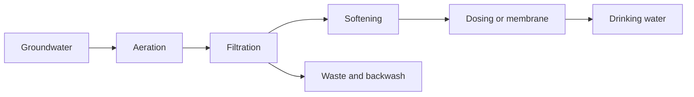

# Drinking-water treatment

Groundwater already holds what the soil and the rock put into it. Iron and manganese stain and cloud the water. Hardness is the calcium and magnesium that leave scale. Methane and carbon dioxide come out of solution when the water meets air. Oxygen is often scarce underground, and that is why the later steps need air before they can oxidise iron or ammonium.

A treatment train is a row of machines, each with one job. Aeration brings the water into contact with air. Filtration catches what oxidation turned into solids. Softening takes hardness out on a pellet bed. A dosing point adds an acid, a base, or another chemical. A membrane holds salts back and lets water through. The library in Amanzi is that set of boxes for a typical Dutch groundwater works. It is not every process a treatment plant on earth might use.

Three kinds of water leave a box.

**Product water** is the stream that continues toward the tap. On the canvas it is the blue line.

**Waste** is water that cannot go to the tap: sludge water, concentrate, or a stream sent aside. On the canvas it is the red line. In the demo, red pipes from the filters meet at **Afvalstroom**.

**Backwash**, or flush, is the water used to wash a filter clean. On the canvas it is the dotted line, often running back along the top of the train.

A drawing of boxes and arrows is a useful model because the plant really is a sequence of those jobs, and the water really does split into product and the streams you do not drink. The drawing is the model Amanzi calculates. Positions on the page are for you. The calculation uses the flows and the elevations you type.

The demo project is one such train: abstraction, plate aeration, sand filtration, tower aeration, pellet softening, a second filter, a reservoir, and delivery. Walk it in [Your first plant](../tutorials/first-plant.md).
