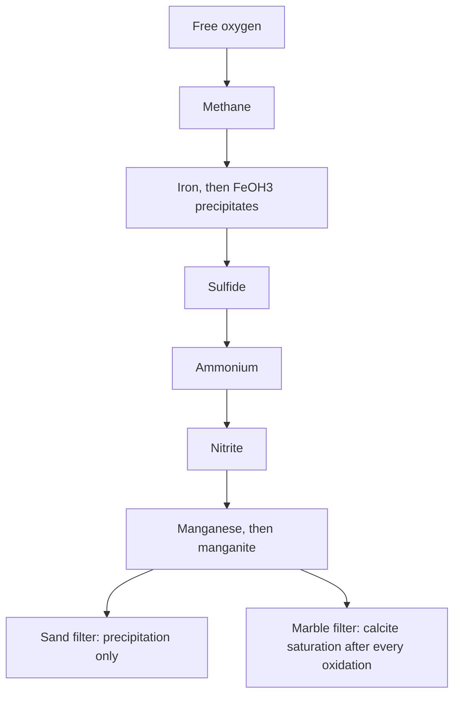

# Filtration

A rapid filter in Amanzi is an oxygen-limited bed. Dissolved iron, manganese, sulfide, and ammonium only convert as far as the free oxygen allows, and in a fixed order. Marble filtration is the same sequence with one extra equilibrium: after each oxidation the water is brought back to calcite saturation, so the bed buffers pH. Fields and the dual-media dimensions are in the [sand filter](../reference/process-units/sandfiltration.md) and [marble filter](../reference/process-units/marblefiltration.md) references.

## The shared sequence

Inert oxygen carried as `Oxg` is turned into free `O2` first. Then, while oxygen lasts:

1. Methane (`Mtg`) oxidises. The oxygen demand in the model is 2 per methane.
2. Ferrous iron oxidises and the water is desaturated to amorphous ferric hydroxide. The iron that disappears here is the load the backwash must carry.
3. Sulfide oxidises.
4. Ammonium oxidises, then nitrite.
5. Manganese oxidises and the water is desaturated to manganite.

Each step consumes oxygen in the ratio written in the model, and it cannot convert more reactant than that oxygen budget. On a sand filter, iron, ammonium, and manganese can be held below full removal by a suppression efficiency. Marble filtration runs the same chain and calls `saturate("Calcite", 0)` at the end of each oxidation, which is the pH buffering a marble bed is there to provide.

The design view lists those steps as a small speciation table: influent, methane, iron, sulfide, nitrification, nitrite, manganese. The plant walk only passes the finished water downstream. If spray aeration is on, the table gains a spray column and the oxidation sees the aerated water. The spray curve is the one described under [Aeration](aeration.md).

## Sand and anthracite

The quality sequence does not contain a separate anthracite reaction. Dual media is a hydraulic choice: an anthracite layer with its own height, grain size, and porosity, drawn above the sand when it is switched on. Clean-bed head loss uses a Kozeny–Carman expression. Backwash head loss and bed expansion use a 15 °C viscosity (1.1375×10⁻³ Pa·s). The expansion routine notes that it does not yet follow temperature. Backwash water receives the captured iron, either from the run volume or from runtime and nominal capacity, depending on the backwash control.

## What the plant walk does not show

An unpublished marble-filter variant exists beside the library model. It is not a unit you can place. The library marble filter is the production model: the oxidation sequence, calcite saturation, and the same backwash iron account.

Head loss is a hydraulic result. The quantity of filtrate and the quantity of flush are the mass balance. A filter can be hydraulically fine and still fail the oxygen budget, or the other way around. The two solvers do not substitute for each other.
