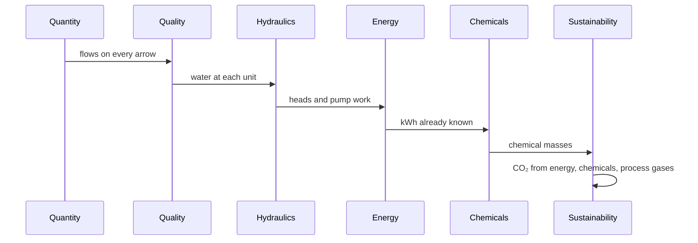

# How Amanzi calculates

A project file is a list of scenarios. Each scenario names its units, their settings, and the connections between them. Amanzi builds one model object per unit from that type name, attaches the connections, and loads the key-figure database. A project overwrite is written into those defaults. A scenario overwrite is consulted first when a figure is read. The same order is described from the user’s side in [Set key figures](../how-to/set-key-figures.md).

The scenario then runs six solvers, in this order:

**Quantity** collects a linear mass balance from every unit and solves it once. Product, waste, and flush are separate accounts. A splitter divides a stream. A recycle returns water to an earlier unit, so the flows have to be consistent around the loop. The result is a flow on every arrow, in the same units the panel calls Mm³/y.

**Quality** starts from the abstraction analysis as a PhreeqPython solution and walks the graph. Product is traced first, then flush, then waste. Each unit’s `run_quality` returns the water leaving that unit. Where water loops, the walk repeats. It stops when the change is within 0.0001, and it gives up after 100 passes with a mass-balance error. That failure means the recycle did not settle, not that a single unit’s chemistry is undefined.

**Hydraulics** walks heads from the source. Well-pump work uses the key figure `well_efficiency`. A booster on a line uses `booster_efficiency`. Filters and pipes contribute head loss through their own loss calculations. The drawing’s pixel positions are not part of this walk.

**Energy** sums, per unit, the outputs already expressed as kWh/m³, then turns them into a yearly total using the flow through that unit. Connection losses that carry a pump efficiency are added as hydraulic energy.

**Chemicals** reads each unit’s chemical outputs in g of active substance per m³. It does not invent a second reaction. It records the masses the unit already computed.

**Sustainability** does the same for outputs in gCO₂-eq/m³, adds them, and spreads the yearly total over the water delivered at the output. How those grams are built from the grid factor and the chemical factors is in [Quantity, energy, chemicals, CO₂](quantity-energy-chemicals-co2.md).

Opening a unit can run a richer `design()` than the plant walk. A filter’s design view shows the oxidation steps one by one. A dosing or softening view sweeps a dose and draws the curves. The plant walk only needs the water that leaves the unit. The curves are there so you can see the step, and they use the same functions.

Many numeric outputs are not handwritten in Python. They are equations in a small YAML catalogue: an expression, the inputs it may use, a condition for when the row is visible, and a check. The catalogue is how electricity consumption becomes CO₂, and how a chemical mass becomes a chemical emission. The schema itself belongs in the architecture notes, not here.
