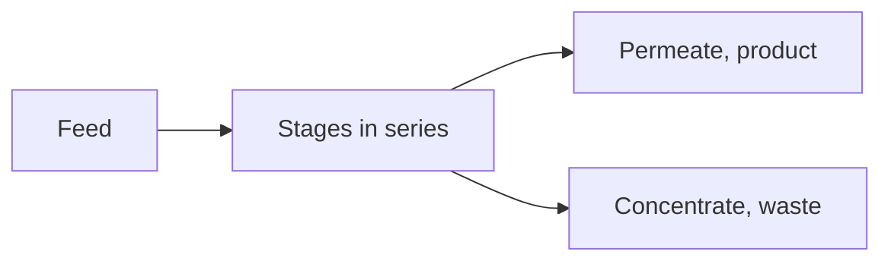

# Membranes

Amanzi has three membrane-family units. A reverse-osmosis or nanofiltration stack holds dissolved solids back. A membrane contactor and a vacuum stripper pull gases out by lowering pressure. They answer different questions: salts, or gases. Fields are in the [membrane](../reference/process-units/membrane.md), [membrane degassing](../reference/process-units/membranedegassing.md), and [vacuum](../reference/process-units/vacuum.md) references.

## RO and NF stacks

Recovery is the share of feed that becomes permeate. The rest leaves as concentrate, on the waste anchor. The stack is a series of stages. Each stage is a set of pressure vessels, and each vessel is a row of elements.

The element list is a table of manufacturer test points: name, salt rejection, test flux, test pressure, test recovery, and the element area. Names such as ESPA2-LD and AK-400H are rows in that table, not separate scientific models. Water permeability Kw is backed out of the test point. Net driving pressure uses an osmotic pressure proportional to TDS, with a sodium-chloride coefficient, and Kw is then shifted by 3 % per degree away from 25 °C. Spacer head loss follows the relation used in the TU Delft nanofiltration and reverse-osmosis notes. Feed pressure is solved so the requested recovery is met at the feed temperature and TDS.

Quality uses that same rejection. Each dissolved component is reduced in the permeate by the element rejection, and what was held back enriches the concentrate. This is not a solution-diffusion model with a permeability per ion. Two elements with the same rejection treat calcium and sodium alike, apart from the chemistry PHREEQC still applies to the resulting water. Supersaturation of the concentrate is reported because scaling is the practical limit of recovery.

Optiflux, when it is on, doubles the number of vessels and halves the number of modules per vessel. It is a staging choice for flux, not a different membrane.

Use a stack when the goal is salts: hardness you do not want to pellet, or a TDS a filter will not touch. It spends high-pressure pump energy, and the concentrate is a waste stream the quantity balance will count as loss unless you do something else with it.

## Membrane degassing

A contactor puts the water in contact with a sweep gas at a set vacuum. The model allows one or two stages. Each stage has its own vacuum and its own nitrogen and carbon-dioxide sweep ratios. PHREEQC’s `interact` equilibrates the water with that gas. Stage two sees the water that left stage one. This is the unit to reach for when oxygen pickup from an open aerator is unwelcome and the gases of interest are CO₂ and nitrogen.

## Vacuum stripper

The stripper equilibrates the water with a gas phase at the vacuum you set. The gas includes nitrogen, methane, carbon dioxide, oxygen, water, and hydrogen sulfide as `H2Sg`. The design view sweeps that pressure and plots pH, saturation index, and the gases, so you can see how hard a vacuum has to be before methane or hydrogen sulfide actually leaves. It is the gas tool. It is not the tool that removes sodium chloride. For that, return to the stack. For a blower and a packed bed, return to [Aeration](aeration.md).
