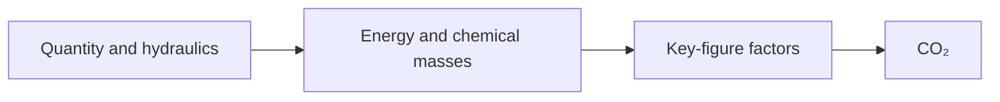

# Quantity, energy, chemicals, CO₂

Quality says what is in the water. The other results are accounts on top of the flows, the heads, and the doses. They are not a second physical simulation.

## Quantity

**Abstraction** is the product water leaving every unit that has nothing upstream. On the demo that is **Winning**. **Distribution** is the product water entering every unit that has nothing downstream. On the demo that is **Levering**. **Loss** is abstraction minus distribution. It is the water that left as waste or as flush and did not return to the product. The panel also shows that loss as a percentage of abstraction.

A recycle that really returns flush water reduces the loss, because that water is no longer missing at the outlet. A waste unit that has no way back increases it.

## Energy

Each unit that consumes electricity reports kWh per cubic metre of the water it treats. The yearly total is that intensity times the flow. Wells use `well_efficiency` when the hydraulic walk turns lift into pump work. Boosters on a line use `booster_efficiency`. Blowers, vacuum pumps, and high-pressure membrane feed pumps add their own power where the unit defines it. Head loss on a connection is included when that connection has an efficiency, so the energy total can contain a line called hydraulic losses as well as the units.

The panel splits the plant total into treatment and distribution. Distribution is the share that belongs to the outlet unit. Treatment is the rest.

## Chemicals

Dosing, softening, and membrane cleaning report chemical use as grams of active substance per cubic metre (g AS/m³). The chemical solver copies those outputs. It does not choose a chemical the unit did not add. The masses are what the sustainability step multiplies by an emission factor.

## CO₂

Each unit can report grams of CO₂-equivalent per cubic metre. The usual pieces are:

- electricity, as kWh/m³ times `carbon_intensity_grid` (gCO₂/kWh)
- each chemical mass, times that chemical’s factor in the key figures (lye, lime, CO₂, acids, and the others in the list)
- process gas where a unit emits it, such as methane stripped or oxidised, times the methane factor

The sustainability solver adds the unit totals and divides by the delivered flow, which is why the panel can show a specific emission per cubic metre delivered and a total in tonnes per year. On the unmodified demo those read 335 gCO₂-eq/m³ and 3177 t/y at a grid factor of 250 gCO₂/kWh. Changing the grid factor moves both numbers and leaves the drawing alone. That is what a key-figure overwrite is for.

These families wait until quantity, quality, and hydraulics have finished. A CO₂ figure cannot be more physical than the dose and the kilowatt-hour it was multiplied from.
