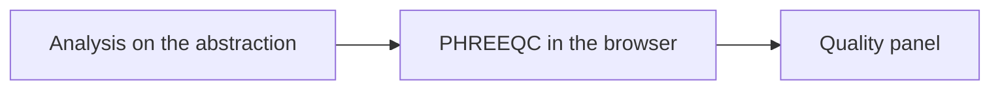

# Reading water quality

The **Quality** panel is the water at the end of the scenario, calculated from the analysis on the abstraction. You type that analysis. Amanzi does not ask you to run a separate chemistry program. Under the page, [PHREEQC](literature.md) through PhreeqPython turns the analysis into the rows below.

**pH** says how acidic or alkaline the water is. Plants watch it because it moves corrosion, the chance that calcite will dissolve or deposit, and how other steps behave.

**Hardness** is the “lime” in the water, mostly calcium and magnesium. It scales heaters and leaves spots. Pellet softening exists to bring it down. On a softening unit the drawing may label the same idea **TH**. The plant panel calls it **Hardness**.

**Fe** and **Mn** are iron and manganese. They stain and cloud the water once oxygen reaches them. Sand filters exist to oxidise them and hold the solids.

**NH₄** is ammonium. Filters can oxidise it onward toward nitrite and nitrate when oxygen is available.

**O₂** is dissolved oxygen. Groundwater is often poor in it. Aeration is how the train gains oxygen and, at the same time, lets other gases leave.

**HCO₃** is bicarbonate, the main alkaline part of many groundwaters. **TAC** on the panel is that alkalinity, shown as the plant reports it. **SI** is the saturation index for calcite: above zero the water tends to deposit calcite, below zero it tends to dissolve it. **TACC₉₀** is the calcium-carbonate precipitation potential used as a practical measure of that tendency. **AggCO₂** is aggressive carbon dioxide, the part of the CO₂ that can still dissolve calcite. Softening and dosing move these together, which is why a base dose changes hardness and the carbon-dioxide picture at once.

**EGV** is electrical conductivity, a quick measure of how much dissolved material the water carries. In the key-figure list the same idea appears as conductivity at 20 °C. **TDS** is total dissolved solids, the mass of that material. **Na** and **Cl** are sodium and chloride, two of the ions that raise both.

Methane, carbon dioxide, and hydrogen sulfide are why the aeration units exist. They are tracked inside those units. The plant panel’s gas row is **O₂**.

Limits and thresholds for these rows live in the key figures. How a project or a scenario can replace one is in [Set key figures](../how-to/set-key-figures.md).
