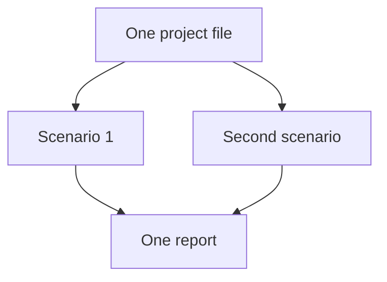

# Scenarios and flowsheets

The canvas is a mass balance. A flowsheet says: this much water, of this quality, enters here; these units change it; this much leaves as product and this much leaves as waste or flush. Amanzi solves that balance, then walks the chemistry along the same arrows.

The balance is steady. One scenario is one operating point: the capacities and settings you typed, held constant. It is not a film of a day, and the tabs along the bottom are not Monday and Tuesday. They are two designs of the same kind of plant. A second tab that keeps the layout and changes one number is a what-if. A blank tab from **+** is an empty canvas, which is a new drawing rather than a comparison.

Where you drop a box is for reading the drawing. Head, pump lift, and pipe loss are numbers on the units and the lines. Sliding a box across the grid does not change the hydraulic grade.

The project file is the model. The page is the editor. Download writes that model as JSON: scenarios, connections, settings, notes, and any key-figure overwrites. Open reads it back. Notes on a scenario are for you. They do not enter the balance.

The panel on the right is the scenario that is open. The report is where both scenarios can sit on one page. How that comparison is turned on is in [Compare in the report](../how-to/compare-in-report.md).
