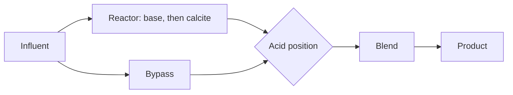

# Softening and dosing

Pellet softening and the dosing block are both ways of adding a chemical and letting PHREEQC say what the water became. Softening is built around calcite. Dosing is a single chemical aimed at a constant dose or at a target. Emission factors for the chemicals live in the key figures, so the CO₂ account follows the kilograms. See [Quantity, energy, chemicals, CO₂](quantity-energy-chemicals-co2.md) and the [softening](../reference/process-units/softening.md) and [dosing](../reference/process-units/dosing.md) references.

## Pellet reactor

The reactor dose is a base, in mmol/L, added to the water that enters the pellets. If iron or manganese capture is set above zero, the corresponding carbonate is removed in that proportion before the calcite step. The water is then desaturated to calcite at the saturation index `soften_to_si`. That index is the target. A target near zero is a water that neither deposits nor dissolves calcite strongly. The base dose is how hard you push to get there. On the demo, **Pelletontharding** starts at 2 mmol/L. Lowering it leaves more hardness in the product, which is why **TH** on the drawing and **Hardness** on the plant panel both rise.

Part of the flow can miss the reactor. Bypass is a fraction of the combined reactor and bypass capacity, not a splitter you place beside the unit. The product is the blend of softened water and bypass water. Acid can be added in three places: at the reactor outlet, into the bypass, or after the blend. The acid chemical and its dose are separate from the base.

The design view sweeps the base dose and records pH, saturation index, and the carbon-dioxide family along the way, which is the family of curves you see as dosing curve HH, HCO₃, and EGV. The plant walk only needs the blended effluent.

Seed and fluidisation are hydraulic. Porosity of the pellet bed is solved from pellet diameter, pellet density, and upward velocity, with water viscosity taken as 1.3×10⁻⁶ m²/s. It answers whether the bed is expanded as you intend. It does not change the calcite equilibrium.

## Dosing block

The dosing unit adds one of: CO₂, hydrochloric acid, sulfuric acid, lye (NaOH), lime, calcite, oxygen, iron chloride, or manganese chloride.

In constant mode the dose is the mmol/L you typed. The field asks for Enter before the drawing accepts it.

In setpoint mode the dose is searched, between 0 and 5 mmol/L, so that the dosed water hits a target. The target can be pH, the calcite saturation index, aggressive CO₂, or TACC₉₀. If the search fails, the dose stays at zero and the unit raises a warning rather than inventing a dose outside that range.

The design view plots pH, oxygen, aggressive CO₂, saturation index, and TACC₉₀ against dose from 0 to 2 mmol/L. Those curves are the reason to open the unit. The scenario uses only the one dose that was selected.

Chemical CO₂ on the sustainability account is the mass of that chemical times its key-figure factor. Lye, lime, and the acids are the same pattern. Changing the factor changes the tonnes of CO₂ and leaves the water chemistry as it was.
