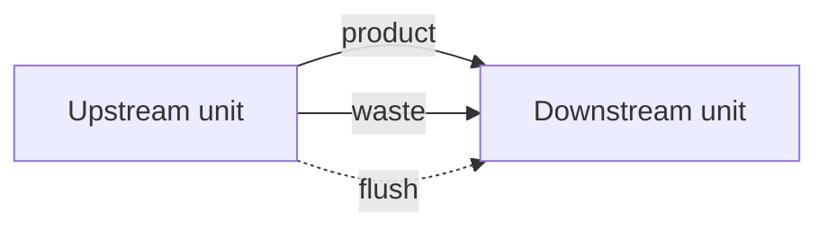

# Add and connect units

Put process units on the canvas and wire product, waste, and flush streams so the scenario can calculate.

The library on the left has two groups: **Main stream** and **Waste stream**. Every scenario needs a source (**Abstraction**) and a sink (**Output**). Stream colours and anchor rules are listed in [Streams](../reference/streams.md).

## Place a unit without connecting it

Drag an icon from the library and drop it on the canvas. The unit stays where you release it. No streams are wired.

<video controls preload="metadata" src="../media/Drag-Drop.mp4" style="max-width: 100%; height: auto;" aria-label="Drag Abstraction from the Main stream library onto the canvas">
Drag an Abstraction unit from the Main stream library onto the canvas.
</video>

## Place a unit and connect it

Two gestures drop the unit and wire it to the nearest free anchors of the same stream type (product to product, waste to waste, flush to flush). An anchor that already has a line is left alone.

**Double-click** an icon in the library. Amanzi places the unit to the right of the units already on the canvas (or in view, when the canvas is empty) and connects it.

<video controls preload="metadata" src="../media/Dubbleclick.mp4" style="max-width: 100%; height: auto;" aria-label="Double-click library icons to add units and connect them automatically">
Double-click Sand filtration, Reservoir, Output, and Waste stream. Each new unit connects to the plant already on the canvas.
</video>

**Hold Shift and drag** an icon onto the canvas when you want to choose the position yourself. Releasing the mouse places the unit there and connects it the same way.

<video controls preload="metadata" src="../media/Shift-drag.mp4" style="max-width: 100%; height: auto;" aria-label="Hold Shift while dragging a unit onto the canvas to place it and connect it">
Hold Shift, drag Sand filtration, Reservoir, Waste stream, and Output onto the canvas, and each one connects where you drop it.
</video>

## Connect anchors yourself

Drag from an **outgoing** anchor to an **incoming** anchor of the same stream. A drag that starts on an inlet does not draw a line.

- **Product** — solid blue. Water continuing along the main train.
- **Waste** — red. Water leaving the process, usually into a **Waste stream** unit.
- **Flush** — dotted blue. Backwash water. On a sand filter the flush inlet is the top anchor; the line starts at the reservoir’s flush outlet.

A red bar at the top of the canvas names a unit that still has a required anchor open, for example: The model "Sand filtration" is not fully connected. The bar clears when every required anchor on that unit has a line. A second line on the same pair of anchors is removed automatically. Values on a line stay **?** until you calculate the scenario.

<video controls preload="metadata" src="../media/ConnectingModels.mp4" style="max-width: 100%; height: auto;" aria-label="Drag product, waste, and flush anchors until Sand filtration is fully connected">
Connect Sand filtration: waste to Waste stream, product to Reservoir, and flush from Reservoir. The red bar clears when the unit is fully connected.
</video>

## Before the scenario can calculate

The same red bar blocks calculation until the canvas has both a source and an output. It shows one of these messages:

- "The model needs a source and a output model"
- "The model needs a source (groundwater extraction) to function"
- "The model needs an outgoing flow (output model)"

Open a placed unit to change its parameters: [Configure a unit](configure-a-unit.md).

## Move around the canvas

Unit position is layout only. The grid does not change the calculation.

- Zoom with the scroll wheel, or with the zoom buttons and percentage menu in the top bar.
- Pan with the arrow tool in the top bar, or with the middle mouse button.
- Open the zoom percentage and choose **Zoom to fit** to bring every unit into view.
