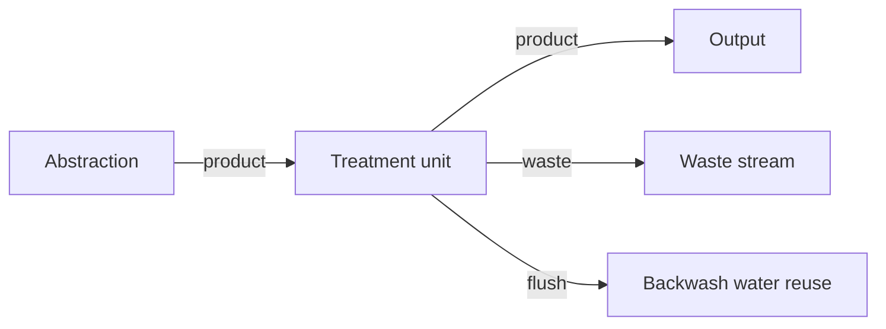

# Streams

A connection joins an anchor on one unit to an anchor of the same type on another. Three types exist.

| Stream | Colour on the canvas | What it carries |
|---|---|---|
| Product | Blue | Water continuing along the train |
| Waste | Red | Water that leaves the drinking-water path: sludge, concentrate, sand-trap flow |
| Flush | Dotted blue | Backwash and other wash water |

Each unit declares its anchors: side, direction (in or out), and type. An anchor that is not marked optional must be wired. The reservoir’s flush outlet is optional. A scenario that is missing a required anchor reports that the unit is not fully connected. A scenario with no source, or with no output, cannot be solved.

A recycle or a splitter can send water back upstream. Quantity solves that loop as one mass balance. Quality walks the loop again until it settles. The limit is 100 passes and a change of 0.0001. The reason is in [How Amanzi calculates](../explanation/how-amanzi-calculates.md).

Product anchors connect to product anchors, waste to waste, flush to flush. An anchor that already has a line is left alone when a new unit is dropped.
