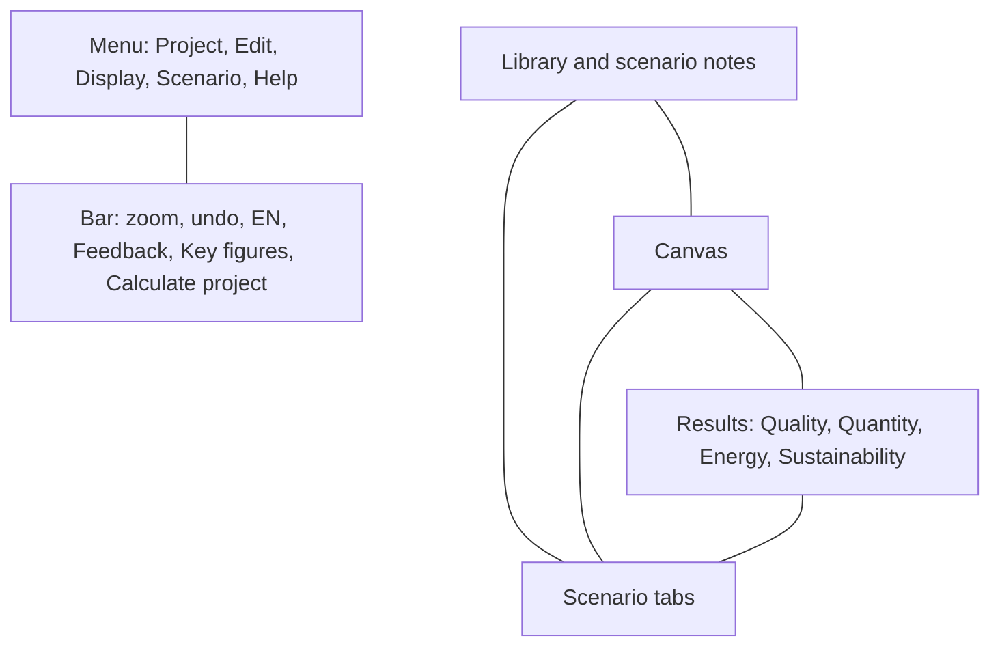

# User interface

Names of the regions in the Amanzi window. The demo opens with the menu in English when the browser language is English.

## Menu

**Project** holds New, Open, Save, Download, Rename project, Key figures, and Calculate project. **Edit** holds undo, redo, and the usual clipboard commands. **Display** holds grid, sidebars, and zoom. **Scenario** holds commands for the open scenario. **Help** holds Tutorial, Documentation, and About Amanzi. Documentation opens the user guide in a new tab, in the language selected on the globe (`en`, `nl`, `de`, or `fr`).

The bar under the menu shows **Unsaved changes, click here to save** or **All changes saved**.

## Top bar

The project name sits in the centre. Clicking it opens **Change name**.

On the left: zoom percent, zoom in and out, undo, redo, select or pan, and the language globe (**EN**, **NL**, **DE**, **FR**).

On the right: **Feedback?**, **Key figures**, and **Calculate project**. Key figures is this button. It is not a tab on the right-hand panel.

## Left

**Scenario** contains the **Notes** box for the open scenario. **Library** is split into **Main stream** and **Waste stream**, with a filter and a grid or list. **Configuration** shows the name of the unit that is selected.

## Canvas

The drawing. Pan and zoom move the view. Block positions are layout. They are not coordinates on a map and they are not elevations.

## Right

**Quality**, **Quantity**, **Energy**, and **Sustainability** for the scenario that is open. What each row means is in [Results](results.md).

## Bottom

One tab per scenario. **+** adds an empty scenario. The options control on a tab duplicates, renames, or removes that scenario.

## Dialogs

Double-clicking a unit opens its design view: a drawing or chart, and the parameters on the left. **Calculate project** opens the report. The first visit shows **Starting AMANZI...** while the calculation program loads, then a **Tutorial** dialog with **Done**. **About Amanzi** shows the GPL-3.0 notice, acknowledgements (PHREEQC, PhreeqPython, Vue, Element Plus), and a BibTeX citation.
