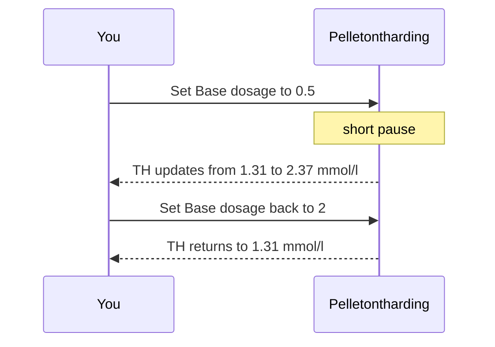

# Change one thing

Change one number on the demo project, watch a result move, and put the number back.

The unit is **Pelletontharding**, on the canvas. The field is **Base dosage**.

## Open the unit

Click **Pelletontharding** once. Under **Configuration**, at the bottom left, the name of the unit appears.

Double-click the unit. The design view opens. Settings are on the left. The drawing is on the right.

## Set Base dosage to 0.5

The design view opens with **Design** selected. Click **Operation**. Under **Dosage**, **Base dosage** reads 2 mmol/L. Click the field and type `0.5`. A line under the field says **Press ENTER to save**. Press Enter.

After a short pause the drawing updates.

- The dose on the drawing goes from **2.00 mmol/l** to **0.50 mmol/l**.
- The dashed line on **Dosing curve HH** moves from 2 to 0.5.
- The green box on the right of the drawing, labelled **TH**, goes from **1.31 mmol/l** to **2.37 mmol/l**.

TH is the hardness of the water leaving this unit. The panel on the right calls the plant result **Hardness**. Those names are explained in [Reading water quality](../explanation/reading-water-quality.md).

While this window is open, **Hardness** on the right stays **1.31 mmol/l**.

<video controls preload="metadata" src="../media/ChangeOneParameter.mp4" style="max-width: 100%; height: auto;" aria-label="Set Base dosage to 0.5, click the red arrow to restore the default of 1, then set it back to 2">
Set Base dosage to 0.5, click the red arrow above the field to restore the default (1 mmol/L), then set it back to 2. The ring marks the cursor. The dosing curve and TH move with each change.
</video>

The clip stays in this window. It sets **Base dosage** to 0.5, clicks the red arrow to restore the default of 1 mmol/L, then sets **2** again, so you can see the drawing move and return. To see the panel on the right change, close the window while **Base dosage** is still 0.5.

## Close the window

Close the design view. The panel on the right updates.

**Hardness** reads **2.37 mmol/l**.

Scroll the panel to **Sustainability**. **Specific emissions** reads **320** gCO₂-eq/m³. It was 335. **Total emissions** reads **3042** ton CO₂-eq/y. It was 3177.

**Quantity** and **Energy** stay on the same numbers. Abstraction stays 10.00 Mm³/y. Treatment stays 0.119 kWh/m³.

The bar at the top turns yellow: **Unsaved changes, click here to save.** Leave it until **Base dosage** is 2 again.

## Put 2 back

The curved arrow beside the zoom buttons stays grey. **Edit → Undo** stays grey.

Double-click **Pelletontharding**. Under **Dosage**, set **Base dosage** back to 2 and press Enter. The dose on the drawing returns to **2.00 mmol/l**, the dashed line returns to 2, and **TH** returns to **1.31 mmol/l**.

Close the window. **Hardness** returns to **1.31 mmol/l**. **Specific emissions** returns to 335 gCO₂-eq/m³. **Total emissions** returns to 3177 ton CO₂-eq/y.

Other fields on a unit are in [Configure a unit](../how-to/configure-a-unit.md).
