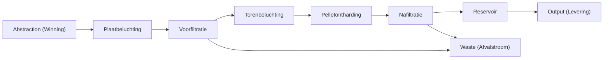

# Your first plant

The demo project is already on the screen. Water comes in at the left, passes the treatment blocks, and leaves at the right. This page only walks that plant. Leave every value as you find it.

## Follow the drawing

Every scenario needs a source and a sink. This demo already has both. **Abstraction** is the representation of the wells and act as source while **Output** is the sink and represents the distribution after the treatmentprocess.

The product path is shown with the blue arrows. Left to right the blocks are **Abstraction**, **Plater Aeration**, **Sandfilter 1**, **Tower Aeration**, **Pellet hardening**, **Sandfilter 2**, **Reservoir**, and **Output**. Between the reservoir and the sandfilter are dotted blue connections which show the connection of the backwash water for the filters.  

**Waste stream** sits on the waste line, under the train. Red pipes run to it from both Sandfilters. Waste pipes are red. 

<video controls preload="metadata" src="../media/WalkDemoPlant.mp4" style="max-width: 100%; height: auto;" aria-label="Follow the blue pipes from Winning to Levering, pause on Afvalstroom, then select Voorfiltratie">
The cursor follows the blue pipes from Winning to Levering, pauses on Afvalstroom so the red waste pipe is clear, and selects Voorfiltratie.
</video>

A red unit means it is not fully connected, and the fix is in [Add and connect units](../how-to/add-and-connect-units.md).

## The result on the right

The right sidebar is already filled in before you click a block. It is the result for the whole plant. Four headings:

**Quality** lists what is in the water: pH, EGV, O₂, HCO₃, TAC, Hardness, TDS, TACC₉₀, AggCO₂, SI, Fe, Mn, NH₄, Na, and Cl.

**Quantity** lists Abstraction, Distribution, and Loss, and Abstraction reads 10.00 Mm³/y.

**Energy** lists Treatment, Distribution, and Total.

**Sustainability** is the last heading and lists Specific emissions and Total emissions.

## Select one block

Click **Pellet hardening** once. A blue outline shows the block is selected. At the bottom left, **Configuration** shows the **Name** and a button **Edit model parameters**. Clicking on this button or double clicking on the block itself brings you to detailed design view of this model. 
There you can [change ever design parameter](change-one-thing.md).
