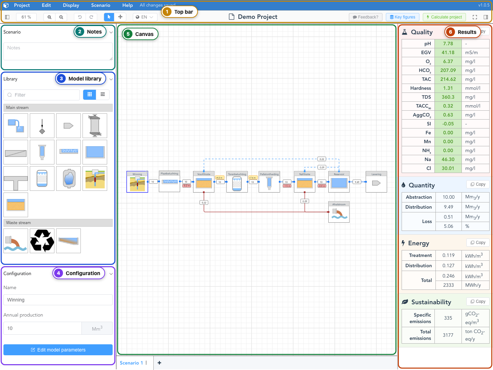

# Open Amanzi

Open the app and learn the names of the screen. Leave the plant as you find it.

## Open the app

Open [https://demo.amanzi.app](https://demo.amanzi.app).

The first time, a window titled **Starting AMANZI...** stays up while the calculation program loads. It closes by itself.

<video controls preload="metadata" src="../media/StartingAmanzi.mp4" style="max-width: 100%; height: auto;" aria-label="Wait while Starting AMANZI... loads the calculation program, then closes">
The window titled Starting AMANZI... stays on screen while the calculation program loads, then closes by itself.
</video>

To unzip a release and serve that copy, follow [Open hosted or local](../how-to/open-hosted-or-local.md).

## Close the tutorial

A dialog titled **Tutorial** may then cover the project. Click thorugh it to see the core functionalites and how Amanzi is used. 
All the information can also be found in this tutorial walkthrough. 
If you already know how Amanzi works, check the box on the bottom left before clicking the tutorial away to make sure it doesnt open again on you next visit to the site. 

**Help → Tutorial** opens the tutorial tour again when you want it. 

## The screen

Amanzi is divided into three main sections. The scenario tooling on the left, the canvas in the middle and the result overview on the right. 

Scenario tooling includes: 
- Notes field to add considerations or assumptions that have to be noted for the current scenario
- Model library, which includes all water treatment and wastestream models that can be used to build the treatment train
- Configuration field, which is displayed when selecting a model and quickly change selected parameter or go further to the design view

The Canvas is the sandbox in which you the user can place different model blocks and connect them to a treatment train for your application. You can drag and drop models into the canvas and have them auto connect, see more under [Add and connect units](add-and-connect-units.md)

In the result overview Amanzi displays a number of resultsparameter for the KPIs Quality, Quantity, Energy and Sustainability. 
For Quality the individual compounds are color coded to show if they are below the drinkingwater norms or not. 

In the top bar are navigation tools, languange setting and other features. 

This documentation site has its own **English**, **Nederlands**, and **Deutsch** copies, and the architecture documentation stays English.

Next, walk the plant that is already drawn: [Your first plant](first-plant.md).
