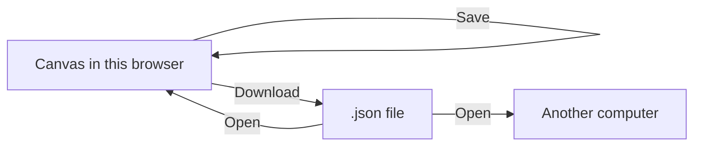

# Save your work

The project lives in this browser. Save it here, download a `.json` file, and open that file again.

**Save** stays on the canvas in this browser. **Download** writes the `.json` file. **Open** reads that file onto this canvas or onto another computer.

## Save in this browser

Edit a note under **Scenario**. The title gains an asterisk, and the bar turns yellow: **Unsaved changes, click here to save.**

Click that bar, or choose **Project → Save**. On a Mac the shortcut is ⌘S. Elsewhere it is Ctrl+S. The bar then should say **All changes saved**.

Leave the page and come back. The saved project is still in this browser. 
In order to share your project saving it is not enough and you have to download the project.

<video controls preload="metadata" src="../media/SaveInBrowser.mp4" style="max-width: 100%; height: auto;" aria-label="Edit a scenario note and save until the bar says All changes saved">
Type a note under Scenario, open Project, and click Save so the bar changes from Unsaved changes to All changes saved.
</video>

## Download a file

Click the project name, or choose **Project → Rename project**. The dialog title is **Change name**. Type a name and click **Save**.

**Project → Download** writes a `.json` file named after the title. **North plant** becomes `North plant.json`.

A name change alone does not turn the bar yellow. **Download** does not clear **Unsaved changes** by itself. **Save** does, and this browser keeps the new name.

Details of rename, and of **Project → New...**, are in [Save, load, download](../how-to/save-load-download.md).

<video controls preload="metadata" src="../media/DownloadJson.mp4" style="max-width: 100%; height: auto;" aria-label="Open the Project menu and download the project as a JSON file">
Open Project and click Download to write the .json file.
</video>

## Open the file

**Project → Open** replaces the project on screen. Amanzi does not ask first. The file window is the system one, so it is not in the clip. In the clip the canvas starts empty, and **Open** brings **North plant** back, notes included.

You can email the `.json`. A colleague opens the same file with **Project → Open**.

<video controls preload="metadata" src="../media/OpenProject.mp4" style="max-width: 100%; height: auto;" aria-label="Open a JSON file from an empty project and bring North plant back with its notes">
From an empty New project, click Open, and the file returns as North plant with its notes.
</video>

## An older file

An older file can show **Project file updated**. What that notice lists is in [Save, load, download](../how-to/save-load-download.md).
