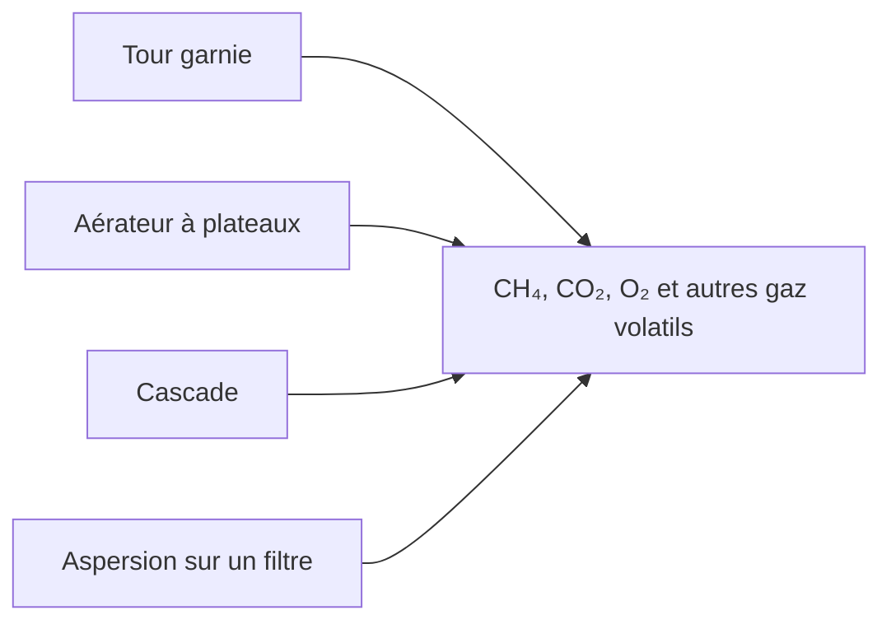

# Aération

L'eau souterraine arrive pauvre en oxygène et riche en gaz qui ont leur place dans l'air : méthane, dioxyde de carbone, et parfois sulfure d'hydrogène. L'aération est le contact qui déplace ces gaz. L'oxygène entre. Les autres sortent, dans la mesure que fixe la géométrie. La bibliothèque propose trois aérateurs que vous pouvez placer : une tour garnie, un aérateur à plateaux et une cascade. Un filtre à sable ou à marbre peut aussi asperger l'eau sur le lit. Le bloc d'aspersion lui-même n'est pas dans la bibliothèque. Les citations sont dans [Littérature](literature.md). Les champs sont dans la [référence des unités de procédé](../reference/process-units/index.md).

## Tour garnie

L'eau tombe à travers le garnissage pendant que l'air est soufflé vers le haut. Le coefficient de transfert de matière suit la corrélation d'Onda : coefficients côté gaz et côté liquide, une aire mouillée, et une hauteur d'unité de transfert. La hauteur de tour divisée par cette HTU donne le nombre d'unités de transfert, et de là l'élimination de chaque composé. La constante de Henry et les diffusivités viennent des coefficients stockés pour chaque gaz. Le rapport air-eau et la concentration du gaz à l'entrée ferment le bilan. Pour le CO₂, l'air d'entrée reçoit une faible teneur en dioxyde de carbone. Pour les autres gaz, il est pris comme propre.

L'hydraulique du garnissage suit Engel et Stichlmair : rétention statique, rétention dynamique, perte de charge, et une ligne d'engorgement. La puissance de la soufflante est une compression isentropique depuis la pression atmosphérique à travers cette perte de charge, divisée par le rendement de la soufflante. Les noms de garnissage dans le modèle sont les tailles Raflux. La vue de conception trace le point de fonctionnement sur la courbe d'engorgement, de sorte qu'un diamètre qui engorge se voit comme une colonne engorgée, et non comme un rendement silencieux.

Une tour est l'aérateur à choisir lorsque le gaz doit vraiment être extrait par strippage, y compris les composés volatils qu'une cascade courte effleure à peine. C'est aussi l'aérateur qui a une soufflante à alimenter et une limite d'engorgement à respecter.

## Aérateur à plateaux

Un aérateur à plateaux mélange l'eau avec une phase gazeuse dans l'`interact` de PHREEQC. Le gaz est le rapport d'air que vous réglez. Sans recirculation, ce contact a lieu une fois. Avec recirculation des gaz de sortie, le contact est répété quelques fois, et le volume d'air neuf est le rapport d'air diminué des gaz de sortie renvoyés. C'est un plateau pratique, pas une corrélation de colonne garnie. Utilisez-le lorsque la filière a besoin d'un premier contact avec l'air, comme le fait la démo à **Aération à plateaux**, et que l'élimination poussée du méthane peut attendre une tour plus loin.

## Cascade

Une cascade est un empilement de marches. Pour l'oxygène et le dioxyde de carbone, l'efficacité par marche est une fonction empirique du logarithme de la hauteur de marche. Pour le méthane, l'efficacité est un polynôme de la hauteur de marche, et la concentration de saturation est interpolée à 10 °C dans la table de solubilité de Duan et Mao. La variation de concentration sur l'ensemble de la cascade est

ΔC = (Csat − Cin) · (1 − (1 − k)^steps).

La vue de conception répète ce calcul pour une à huit marches, afin que vous voyiez le pH, le CO₂, l'oxygène et le méthane évoluer avec le nombre de marches. Une cascade est l'aérateur extérieur simple : pas de soufflante, un effet modeste sur le méthane, un effet clair sur l'oxygène et le dioxyde de carbone.

## Aspersion sur un filtre

Lorsque l'aspersion est activée sur un filtre à sable ou à marbre, l'eau est aérée avant la séquence d'oxydation. L'efficacité est un polynôme de la hauteur de chute, ajusté à une courbe de buse de TU Delft et de Dresden. Un modèle de goutte avec un diamètre de Sauter est présent dans le code en commentaire, et ce n'est pas lui qui s'exécute. Considérez le polynôme comme un ajustement de courbe pour cette buse, pas comme une théorie générale de l'aspersion.

## À côté des aérateurs

Un contacteur membranaire ou un stripper sous vide retire les gaz en abaissant leur pression partielle, au lieu de souffler de l'air à travers l'eau. Ils se rattachent aux [membranes](membranes.md). Choisissez-les lorsque l'eau produite ne doit pas se charger en oxygène, ou lorsqu'un gaz doit être extrait plus fort qu'une cascade ne peut le faire.
