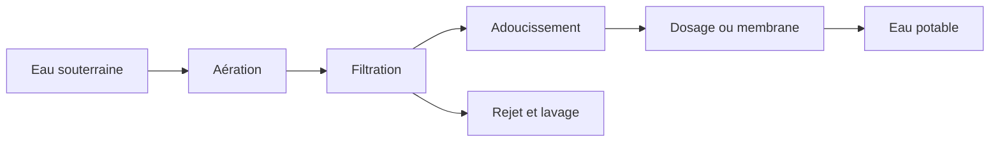

# Traitement de l'eau potable

L'eau souterraine contient déjà ce que le sol et la roche y ont mis. Le fer et le manganèse tachent l'eau et la troublent. La dureté est le calcium et le magnésium qui laissent du tartre. Le méthane et le dioxyde de carbone se dégagent lorsque l'eau rencontre l'air. L'oxygène est souvent rare en sous-sol, et c'est pourquoi les étapes suivantes ont besoin d'air avant de pouvoir oxyder le fer ou l'ammonium.

Une filière de traitement est une suite d'appareils, chacun avec une tâche. L'aération met l'eau en contact avec l'air. La filtration retient ce que l'oxydation a transformé en solides. L'adoucissement retire la dureté sur un lit de pellets. Un point de dosage ajoute un acide, une base ou un autre réactif. Une membrane retient les sels et laisse passer l'eau. La bibliothèque d'Amanzi est cet ensemble de boîtes pour une usine type d'eau souterraine aux Pays-Bas. Elle ne couvre pas tous les procédés qu'une usine de traitement pourrait employer.

Trois sortes d'eau quittent une boîte.

L'**eau produite** est le flux qui continue vers le robinet. Sur le canevas, c'est le trait bleu.

Le **rejet** est l'eau qui ne peut pas aller au robinet : eau de boue, concentrat, ou un flux mis à l'écart. Sur le canevas, c'est le trait rouge. Dans la démo, les conduites rouges des filtres se rejoignent à **Flux de rejet**.

Le **lavage** est l'eau utilisée pour nettoyer un filtre. Sur le canevas, c'est le trait pointillé, qui revient souvent le long du haut de la filière.

Un dessin de boîtes et de flèches est un modèle utile, parce que l'usine est vraiment une suite de ces tâches, et que l'eau se partage vraiment entre l'eau produite et les flux que l'on ne boit pas. Le dessin est le modèle qu'Amanzi calcule. Les positions sur la page sont pour vous. Le calcul utilise les débits et les cotes que vous saisissez.

Le projet de démo est une filière de ce type : captage, aérateur à plateaux, filtration sur sable, aération en tour, adoucissement sur lit de pellets, un second filtre, un réservoir et la distribution. Parcourez-la dans [Votre première usine](../tutorials/first-plant.md).
