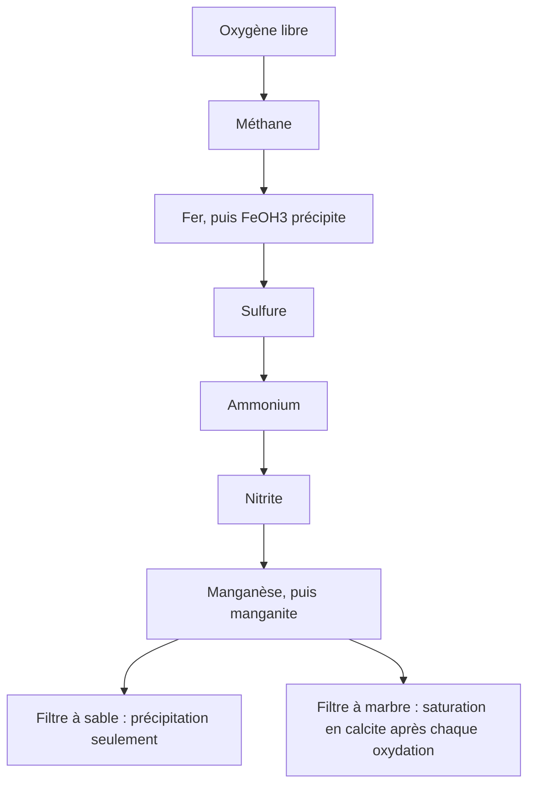

# Filtration

Un filtre rapide dans Amanzi est un lit limité par l'oxygène. Le fer dissous, le manganèse, le sulfure et l'ammonium ne se convertissent que dans la mesure où l'oxygène libre le permet, et dans un ordre fixe. La filtration sur marbre est la même séquence avec un équilibre de plus : après chaque oxydation, l'eau est ramenée à la saturation en calcite, de sorte que le lit tamponne le pH. Les champs et les dimensions du milieu bicouche sont dans les références [filtration sur sable](../reference/process-units/sandfiltration.md) et [filtration sur marbre](../reference/process-units/marblefiltration.md).

## La séquence commune

L'oxygène inerte porté sous la forme `Oxg` est d'abord transformé en `O2` libre. Ensuite, tant qu'il reste de l'oxygène :

1. Le méthane (`Mtg`) s'oxyde. La demande en oxygène dans le modèle est de 2 par méthane.
2. Le fer ferreux s'oxyde et l'eau est désaturée jusqu'à l'hydroxyde ferrique amorphe. Le fer qui disparaît ici est la charge que le lavage doit emporter.
3. Le sulfure s'oxyde.
4. L'ammonium s'oxyde, puis le nitrite.
5. Le manganèse s'oxyde et l'eau est désaturée jusqu'à la manganite.

Chaque étape consomme l'oxygène dans le rapport écrit dans le modèle, et elle ne peut pas convertir plus de réactif que ce budget d'oxygène. Sur un filtre à sable, le fer, l'ammonium et le manganèse peuvent être maintenus en deçà de l'élimination complète par une efficacité de suppression. La filtration sur marbre exécute la même chaîne et appelle `saturate("Calcite", 0)` à la fin de chaque oxydation : c'est le tamponnage du pH qu'un lit de marbre est là pour assurer.

La vue de conception présente ces étapes dans un petit tableau de spéciation : entrée, méthane, fer, sulfure, nitrification, nitrite, manganèse. Le parcours de l'usine ne transmet en aval que l'eau finie. Si l'aération par aspersion est activée, le tableau gagne une colonne d'aspersion et l'oxydation voit l'eau aérée. La courbe d'aspersion est celle décrite sous [Aération](aeration.md).

## Sable et anthracite

La séquence de qualité ne contient pas de réaction d'anthracite distincte. Le milieu bicouche est un choix hydraulique : une couche d'anthracite, avec sa propre hauteur, sa granulométrie et sa porosité, dessinée au-dessus du sable lorsqu'elle est activée. La perte de charge du lit propre utilise une expression de Kozeny–Carman. La perte de charge de lavage et l'expansion du lit utilisent une viscosité à 15 °C (1.1375×10⁻³ Pa·s). La routine d'expansion indique qu'elle ne suit pas encore la température. L'eau de lavage reçoit le fer capté, soit à partir du volume de cycle, soit à partir de la durée de marche et de la capacité nominale, selon la commande de lavage.

## Ce que le parcours de l'usine ne montre pas

Une variante non publiée de filtre à marbre existe à côté du modèle de la bibliothèque. Ce n'est pas une unité que vous pouvez placer. Le filtre à marbre de la bibliothèque est le modèle de production : la séquence d'oxydation, la saturation en calcite, et le même compte de fer au lavage.

La perte de charge est un résultat hydraulique. La quantité de filtrat et la quantité de lavage relèvent du bilan de matière. Un filtre peut être correct sur le plan hydraulique et échouer malgré tout au budget d'oxygène, ou l'inverse. Les deux solveurs ne se substituent pas l'un à l'autre.
