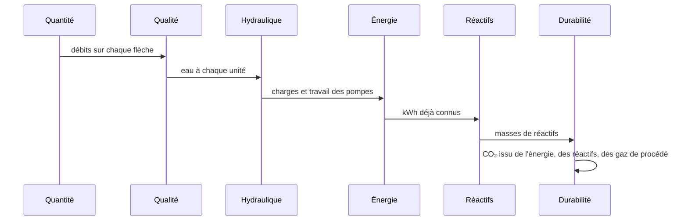

# Comment Amanzi calcule

Un fichier de projet est une liste de scénarios. Chaque scénario nomme ses unités, leurs réglages et les connexions entre elles. Amanzi construit un objet de modèle par unité à partir de ce nom de type, rattache les connexions et charge la base des indicateurs. Une redéfinition de projet est inscrite dans ces valeurs par défaut. Une redéfinition de scénario est consultée en premier lorsqu'un indicateur est lu. Le même ordre est décrit du côté de l'utilisateur dans [Définir les indicateurs](../how-to/set-key-figures.md).

Le scénario exécute ensuite six solveurs, dans cet ordre :

La **quantité** rassemble un bilan de matière linéaire auprès de chaque unité et le résout une seule fois. L'eau produite, le rejet et le lavage sont des comptes distincts. Un diviseur répartit un flux. Une recirculation renvoie l'eau vers une unité antérieure : les débits doivent donc être cohérents tout autour de la boucle. Le résultat est un débit sur chaque flèche, dans les unités que le panneau appelle Mm³/y.

La **qualité** part de l'analyse du captage comme solution PhreeqPython et parcourt le graphe. L'eau produite est suivie d'abord, puis le lavage, puis le rejet. Le `run_quality` de chaque unité renvoie l'eau qui quitte cette unité. Là où l'eau boucle, le parcours se répète. Il s'arrête lorsque la variation n'excède pas 0.0001, et il abandonne après 100 passages avec une erreur de bilan de matière. Cet échec signifie que la recirculation ne s'est pas stabilisée, et non que la chimie d'une unité isolée serait indéfinie.

L'**hydraulique** parcourt les charges depuis la source. Le travail de la pompe de puits utilise l'indicateur `well_efficiency`. Un surpresseur sur une conduite utilise `booster_efficiency`. Les filtres et les conduites apportent leur perte de charge par leurs propres calculs de perte. Les positions en pixels du dessin ne font pas partie de ce parcours.

L'**énergie** somme, pour chaque unité, les sorties déjà exprimées en kWh/m³, puis les convertit en un total annuel à l'aide du débit qui traverse cette unité. Les pertes des connexions qui portent un rendement de pompe sont ajoutées comme énergie hydraulique.

Les **réactifs** lisent les sorties chimiques de chaque unité en grammes de substance active par m³. Le solveur n'invente pas une seconde réaction. Il enregistre les masses que l'unité a déjà calculées.

La **durabilité** fait de même pour les sorties en gCO₂-eq/m³, les additionne, et répartit le total annuel sur l'eau délivrée en distribution. La façon dont ces grammes sont construits à partir du facteur du réseau et des facteurs des réactifs est dans [Quantité, énergie, réactifs, CO₂](quantity-energy-chemicals-co2.md).

Ouvrir une unité peut exécuter un `design()` plus riche que le parcours de l'usine. La vue de conception d'un filtre montre les étapes d'oxydation une par une. Une vue de dosage ou d'adoucissement balaie une dose et trace les courbes. Le parcours de l'usine n'a besoin que de l'eau qui quitte l'unité. Les courbes sont là pour que vous voyiez l'étape, et elles utilisent les mêmes fonctions.

Beaucoup de sorties numériques ne sont pas écrites à la main en Python. Ce sont des équations dans un petit catalogue YAML : une expression, les entrées qu'elle peut utiliser, une condition de visibilité de la ligne, et un contrôle. C'est par ce catalogue que la consommation d'électricité devient du CO₂, et qu'une masse de réactif devient une émission de réactif. Le schéma lui-même appartient aux notes d'architecture, pas ici.
