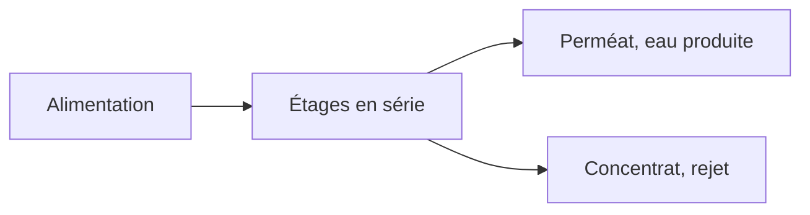

# Membranes

Amanzi compte trois unités de la famille des membranes. Une pile d'osmose inverse ou de nanofiltration retient les solides dissous. Un contacteur membranaire et un stripper sous vide extraient les gaz en abaissant la pression. Ces unités répondent à des questions différentes : les sels, ou les gaz. Les champs sont dans les références [membrane](../reference/process-units/membrane.md), [dégazage membranaire](../reference/process-units/membranedegassing.md) et [vide](../reference/process-units/vacuum.md).

## Piles d'osmose inverse et de nanofiltration

Le taux de conversion est la part de l'alimentation qui devient perméat. Le reste sort en concentrat, sur l'ancrage de rejet. La pile est une série d'étages. Chaque étage est un ensemble de corps de pression, et chaque corps est une rangée d'éléments.

La liste des éléments est une table de points d'essai du fabricant : nom, rejet de sels, flux d'essai, pression d'essai, taux de conversion d'essai, et surface de l'élément. Des noms comme ESPA2-LD et AK-400H sont des lignes de cette table, pas des modèles scientifiques distincts. La perméabilité à l'eau Kw est rétrocalculée à partir du point d'essai. La pression motrice nette utilise une pression osmotique proportionnelle au TDS, avec un coefficient chlorure de sodium, puis Kw est décalé de 3 % par degré d'écart à 25 °C. La perte de charge des espaceurs suit la relation utilisée dans les notes de nanofiltration et d'osmose inverse de TU Delft. La pression d'alimentation est résolue de façon à atteindre le taux de conversion demandé, à la température et au TDS de l'alimentation.

La qualité utilise ce même rejet. Chaque composé dissous est réduit dans le perméat selon le rejet de l'élément, et ce qui a été retenu enrichit le concentrat. Ce n'est pas un modèle solution-diffusion avec une perméabilité par ion. Deux éléments de même rejet traitent le calcium et le sodium de la même façon, hormis la chimie que PHREEQC applique encore à l'eau obtenue. La sursaturation du concentrat est indiquée, parce que l'entartrage est la limite pratique du taux de conversion.

Optiflux, lorsqu'il est activé, double le nombre de corps et divise par deux le nombre de modules par corps. C'est un choix d'étagement pour le flux, pas une autre membrane.

Utilisez une pile lorsque le but porte sur les sels : une dureté que vous ne voulez pas traiter sur pellets, ou un TDS qu'un filtre n'atteint pas. Elle dépense l'énergie d'une pompe haute pression, et le concentrat est un flux de rejet que le bilan de quantité comptera comme une perte, sauf si vous en faites autre chose.

## Dégazage membranaire

Un contacteur met l'eau en contact avec un gaz de balayage sous un vide fixé. Le modèle admet un ou deux étages. Chaque étage a son propre vide et ses propres rapports de balayage en azote et en dioxyde de carbone. L'`interact` de PHREEQC équilibre l'eau avec ce gaz. L'étage deux voit l'eau sortie de l'étage un. C'est l'unité à prendre lorsque l'apport d'oxygène d'un aérateur ouvert est indésirable, et que les gaz visés sont le CO₂ et l'azote.

## Stripper sous vide

Le stripper équilibre l'eau avec une phase gazeuse au vide que vous réglez. Le gaz comprend l'azote, le méthane, le dioxyde de carbone, l'oxygène, l'eau et le sulfure d'hydrogène sous la forme `H2Sg`. La vue de conception balaie cette pression et trace le pH, l'indice de saturation et les gaz, afin que vous voyiez jusqu'où le vide doit être poussé avant que le méthane ou le sulfure d'hydrogène ne parte vraiment. C'est l'outil des gaz. Ce n'est pas l'outil qui retire le chlorure de sodium. Pour cela, revenez à la pile. Pour une soufflante et un lit garni, revenez à l'[Aération](aeration.md).
