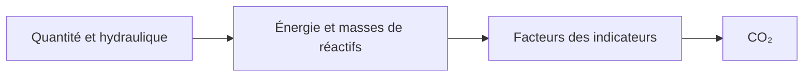

# Quantité, énergie, réactifs, CO₂

La qualité dit ce que contient l'eau. Les autres résultats sont des comptes établis sur les débits, les charges et les doses. Ils ne constituent pas une seconde simulation physique.

## Quantité

Le **captage** est l'eau produite qui quitte chaque unité sans rien en amont. Dans la démo, c'est **Captage**. La **distribution** est l'eau produite qui entre dans chaque unité sans rien en aval. Dans la démo, c'est **Distribution**. La **perte** est le captage moins la distribution. C'est l'eau partie en rejet ou en lavage et qui n'est pas revenue dans l'eau produite. Le panneau montre aussi cette perte en pourcentage du captage.

Une recirculation qui renvoie vraiment l'eau de lavage réduit la perte, parce que cette eau ne manque plus à la sortie. Une unité de rejet sans chemin de retour l'augmente.

## Énergie

Chaque unité qui consomme de l'électricité indique des kWh par m³ de l'eau qu'elle traite. Le total annuel est cette intensité multipliée par le débit. Les puits utilisent `well_efficiency` lorsque le parcours hydraulique transforme la hauteur de relevage en travail de pompe. Les surpresseurs sur une conduite utilisent `booster_efficiency`. Les soufflantes, les pompes à vide et les pompes d'alimentation haute pression des membranes ajoutent leur propre puissance là où l'unité la définit. La perte de charge d'une connexion est incluse lorsque cette connexion a un rendement, de sorte que le total d'énergie peut contenir une ligne appelée pertes hydrauliques, en plus des unités.

Le panneau répartit le total de l'usine entre traitement et distribution. La distribution est la part qui appartient à l'unité de sortie. Le traitement est le reste.

## Réactifs

Le dosage, l'adoucissement et le nettoyage des membranes indiquent l'usage de réactifs en grammes de substance active par m³ (g AS/m³). Le solveur des réactifs copie ces sorties. Il ne choisit pas un réactif que l'unité n'a pas ajouté. Ces masses sont ce que l'étape de durabilité multiplie par un facteur d'émission.

## CO₂

Chaque unité peut indiquer des grammes d'équivalent CO₂ par m³. Les termes habituels sont :

- l'électricité, soit des kWh/m³ multipliés par `carbon_intensity_grid` (gCO₂/kWh)
- chaque masse de réactif, multipliée par le facteur de ce réactif dans les indicateurs (soude, chaux, CO₂, acides, et les autres de la liste)
- le gaz de procédé, là où une unité l'émet, par exemple le méthane extrait par strippage ou oxydé, multiplié par le facteur méthane

Le solveur de durabilité additionne les totaux des unités et divise par le débit délivré. Le panneau peut ainsi afficher une émission spécifique par m³ délivré et un total en tonnes par an. Sur la démo non modifiée, ces valeurs se lisent 335 gCO₂-eq/m³ et 3177 t/y, pour un facteur de réseau de 250 gCO₂/kWh. Changer le facteur de réseau déplace les deux nombres et laisse le dessin tel quel. C'est à cela que sert une redéfinition d'indicateur.

Ces familles attendent que la quantité, la qualité et l'hydraulique aient terminé. Un chiffre de CO₂ ne peut pas être plus physique que la dose et le kilowattheure dont il est le produit.
