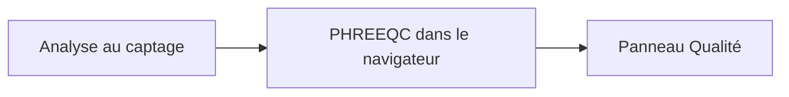

# Lire la qualité de l'eau

Le panneau **Qualité** est l'eau à la fin du scénario, calculée à partir de l'analyse au captage. Vous saisissez cette analyse. Amanzi ne vous demande pas d'exécuter un programme de chimie à part. Sous la page, [PHREEQC](literature.md), par l'intermédiaire de PhreeqPython, transforme l'analyse en les lignes ci-dessous.

Le **pH** dit si l'eau est acide ou alcaline. Les usines le surveillent parce qu'il déplace la corrosion, la probabilité que la calcite se dissolve ou se dépose, et le comportement des autres étapes.

La **dureté** est le « calcaire » de l'eau, surtout le calcium et le magnésium. Elle entartre les chauffe-eau et laisse des taches. L'adoucissement sur lit de pellets existe pour la faire baisser. Sur une unité d'adoucissement, le dessin peut étiqueter la même idée **TH**. Le panneau de l'usine l'appelle **Dureté**.

**Fe** et **Mn** sont le fer et le manganèse. Ils tachent l'eau et la troublent dès que l'oxygène les atteint. Les filtres à sable existent pour les oxyder et retenir les solides.

**NH₄** est l'ammonium. Les filtres peuvent l'oxyder ensuite vers le nitrite et le nitrate lorsque l'oxygène est disponible.

**O₂** est l'oxygène dissous. L'eau souterraine en est souvent pauvre. L'aération est le moyen par lequel la filière gagne de l'oxygène et, en même temps, laisse partir les autres gaz.

**HCO₃** est le bicarbonate, la principale fraction alcaline de beaucoup d'eaux souterraines. Le **TAC** du panneau est cette alcalinité, affichée comme l'usine la rapporte. Le **SI** est l'indice de saturation de la calcite : au-dessus de zéro, l'eau tend à déposer de la calcite ; au-dessous de zéro, elle tend à la dissoudre. Le **TACC₉₀** est le potentiel de précipitation du carbonate de calcium, utilisé comme mesure pratique de cette tendance. **AggCO₂** est le dioxyde de carbone agressif, la part du CO₂ qui peut encore dissoudre la calcite. L'adoucissement et le dosage font bouger ces grandeurs ensemble, ce qui explique qu'une dose de base change à la fois la dureté et l'image du dioxyde de carbone.

L'**EGV** est la conductivité électrique, une mesure rapide de la quantité de matière dissoute que l'eau transporte. Dans la liste des indicateurs, la même idée apparaît comme conductivité à 20 °C. Le **TDS** est la somme des solides dissous, la masse de cette matière. **Na** et **Cl** sont le sodium et le chlorure, deux des ions qui font monter les deux.

Le méthane, le dioxyde de carbone et le sulfure d'hydrogène sont la raison d'être des unités d'aération. Ils sont suivis à l'intérieur de ces unités. La ligne de gaz du panneau de l'usine est **O₂**.

Les limites et les seuils de ces lignes se trouvent dans les indicateurs. La façon dont un projet ou un scénario peut en remplacer un est dans [Définir les indicateurs](../how-to/set-key-figures.md).
