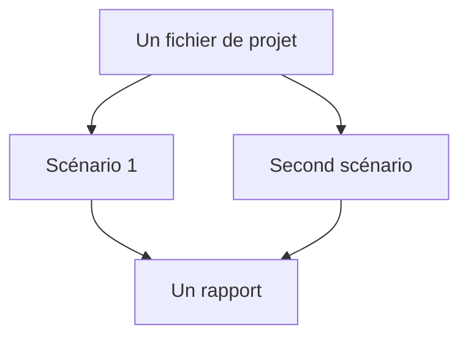

# Scénarios et schémas de procédé

Le canevas est un bilan de matière. Un schéma de procédé dit : tant d'eau, de telle qualité, entre ici ; ces unités la transforment ; tant sort en eau produite et tant sort en rejet ou en lavage. Amanzi résout ce bilan, puis parcourt la chimie le long des mêmes flèches.

Le bilan est stationnaire. Un scénario est un point de fonctionnement : les capacités et les réglages que vous avez saisis, tenus constants. Ce n'est pas le film d'une journée, et les onglets du bas ne sont pas le lundi et le mardi. Ce sont deux conceptions du même type d'usine. Un second onglet qui conserve la disposition et ne change qu'un nombre est une variante « et si ». Un onglet vierge obtenu par **+** est un canevas vide : un nouveau dessin, plutôt qu'une comparaison.

L'endroit où vous déposez une boîte sert à lire le dessin. La charge, la hauteur de relevage et la perte en conduite sont des nombres portés par les unités et par les traits. Faire glisser une boîte sur la grille ne change pas la ligne de charge.

Le fichier de projet est le modèle. La page est l'éditeur. Télécharger écrit ce modèle en JSON : scénarios, connexions, réglages, notes, et toute redéfinition d'indicateur. Ouvrir le relit. Les notes d'un scénario sont pour vous. Elles n'entrent pas dans le bilan.

Le panneau de droite est le scénario qui est ouvert. Le rapport est l'endroit où les deux scénarios peuvent tenir sur une même page. La façon d'activer cette comparaison est dans [Comparer dans le rapport](../how-to/compare-in-report.md).
