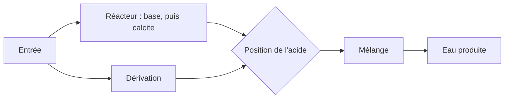

# Adoucissement et dosage

L'adoucissement sur lit de pellets et le bloc de dosage sont deux façons d'ajouter un réactif et de laisser PHREEQC dire ce que l'eau est devenue. L'adoucissement est construit autour de la calcite. Le dosage vise un seul réactif, vers une dose constante ou vers une cible. Les facteurs d'émission des réactifs se trouvent dans les indicateurs, de sorte que le bilan de CO₂ suit les kilogrammes. Voir [Quantité, énergie, réactifs, CO₂](quantity-energy-chemicals-co2.md) et les références [adoucissement](../reference/process-units/softening.md) et [dosage](../reference/process-units/dosing.md).

## Réacteur à pellets

La dose du réacteur est une base, en mmol/L, ajoutée à l'eau qui entre dans les pellets. Si la capture du fer ou du manganèse est réglée au-dessus de zéro, le carbonate correspondant est retiré dans cette proportion avant l'étape calcite. L'eau est ensuite désaturée jusqu'à la calcite, à l'indice de saturation `soften_to_si`. Cet indice est la cible. Une cible proche de zéro est une eau qui ne dépose ni ne dissout fortement la calcite. La dose de base est l'intensité avec laquelle vous poussez pour y arriver. Dans la démo, **Adoucissement sur pellets** part de 2 mmol/L. La baisser laisse davantage de dureté dans l'eau produite, ce qui fait monter à la fois le **TH** sur le dessin et la **Dureté** sur le panneau de l'usine.

Une partie du débit peut éviter le réacteur. La dérivation est une fraction de la capacité combinée du réacteur et de la dérivation, pas un diviseur que vous placez à côté de l'unité. L'eau produite est le mélange de l'eau adoucie et de l'eau de dérivation. L'acide peut être ajouté en trois endroits : à la sortie du réacteur, dans la dérivation, ou après le mélange. Le réactif acide et sa dose sont distincts de la base.

La vue de conception balaie la dose de base et enregistre au passage le pH, l'indice de saturation et la famille du dioxyde de carbone : c'est la famille de courbes que vous voyez comme courbe de dosage HH, HCO₃ et EGV. Le parcours de l'usine n'a besoin que de l'effluent mélangé.

La semence et la fluidisation sont hydrauliques. La porosité du lit de pellets est calculée à partir du diamètre des pellets, de la densité des pellets et de la vitesse ascensionnelle, la viscosité de l'eau étant prise égale à 1.3×10⁻⁶ m²/s. Cela répond à la question de savoir si le lit est expansé comme vous le souhaitez. Cela ne change pas l'équilibre de la calcite.

## Bloc de dosage

L'unité de dosage ajoute l'un des réactifs suivants : CO₂, acide chlorhydrique, acide sulfurique, soude (NaOH), chaux, calcite, oxygène, chlorure de fer ou chlorure de manganèse.

En mode constant, la dose est la valeur en mmol/L que vous avez saisie. Le champ demande Entrée avant que le dessin ne l'accepte.

En mode consigne, la dose est recherchée entre 0 et 5 mmol/L, de façon que l'eau dosée atteigne une cible. La cible peut être le pH, l'indice de saturation de la calcite, le CO₂ agressif ou le TACC₉₀. Si la recherche échoue, la dose reste à zéro et l'unité émet un avertissement, plutôt que d'inventer une dose hors de cette plage.

La vue de conception trace le pH, l'oxygène, le CO₂ agressif, l'indice de saturation et le TACC₉₀ en fonction de la dose, de 0 à 2 mmol/L. Ces courbes sont la raison d'ouvrir l'unité. Le scénario n'utilise que la dose qui a été retenue.

Le CO₂ du réactif, dans le compte de durabilité, est la masse de ce réactif multipliée par son facteur d'indicateur. La soude, la chaux et les acides suivent le même schéma. Changer le facteur change les tonnes de CO₂ et laisse la chimie de l'eau telle qu'elle était.
