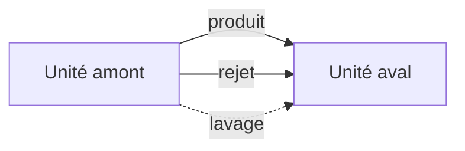

# Ajouter et relier des unités

Placez des unités de traitement sur le canevas et reliez les flux produit, de rejet et de lavage, pour que le scénario puisse calculer.

La bibliothèque à gauche a deux groupes : **Filière principale** et **Flux de rejet**. Chaque scénario a besoin d'une source (**Captage**) et d'une sortie (**Distribution**). Les couleurs de flux et les règles d'ancrage sont listées dans [Flux](../reference/streams.md).

## Placer une unité sans la relier

Glissez une icône depuis la bibliothèque et déposez-la sur le canevas. L'unité reste là où vous la lâchez. Aucun flux n'est relié.

<video controls preload="metadata" src="../media/Drag-Drop.mp4" style="max-width: 100%; height: auto;" aria-label="Glissez Captage depuis la bibliothèque Filière principale vers le canevas">
Glissez une unité Captage depuis la bibliothèque Filière principale vers le canevas.
</video>

## Placer une unité et la relier

Deux gestes déposent l'unité et la relient aux ancrages libres les plus proches, du même type de flux (produit vers produit, rejet vers rejet, lavage vers lavage). Un ancrage qui a déjà une ligne n'est pas repris.

**Double-cliquez** sur une icône de la bibliothèque. Amanzi place l'unité à droite des unités déjà sur le canevas (ou dans la vue, quand le canevas est vide) et la relie.

<video controls preload="metadata" src="../media/Dubbleclick.mp4" style="max-width: 100%; height: auto;" aria-label="Double-cliquez sur les icônes de la bibliothèque pour ajouter des unités et les relier automatiquement">
Double-cliquez sur Filtration sur sable, Réservoir, Distribution et Flux de rejet. Chaque nouvelle unité se relie à l'installation déjà sur le canevas.
</video>

**Maintenez Maj et glissez** une icône sur le canevas quand vous voulez choisir la position vous-même. Relâcher la souris place l'unité là et la relie de la même façon.

<video controls preload="metadata" src="../media/Shift-drag.mp4" style="max-width: 100%; height: auto;" aria-label="Maintenez Maj en glissant une unité sur le canevas pour la placer et la relier">
Maintenez Maj, glissez Filtration sur sable, Réservoir, Flux de rejet et Distribution sur le canevas : chacune se relie là où vous la déposez.
</video>

## Relier les ancrages vous-même

Glissez d'un ancrage **sortant** vers un ancrage **entrant** du même flux. Un glisser qui part d'une entrée ne trace pas de ligne.

- **Produit** — bleu plein. L'eau qui continue le long de la filière principale.
- **Rejet** — rouge. L'eau qui quitte le procédé, en général vers une unité **Flux de rejet**.
- **Lavage** — bleu en pointillés. Eau de lavage. Sur un filtre à sable, l'entrée de lavage est l'ancrage du haut ; la ligne part de la sortie de lavage du réservoir.

Un bandeau rouge en haut du canevas nomme une unité dont un ancrage obligatoire est encore ouvert, par exemple : Le modèle « Filtration sur sable » n'est pas entièrement relié. Le bandeau disparaît quand chaque ancrage obligatoire de cette unité a une ligne. Une deuxième ligne sur la même paire d'ancrages est retirée automatiquement. Les valeurs sur une ligne restent **?** tant que vous n'avez pas calculé le scénario.

<video controls preload="metadata" src="../media/ConnectingModels.mp4" style="max-width: 100%; height: auto;" aria-label="Glissez les ancrages produit, rejet et lavage jusqu'à ce que Filtration sur sable soit entièrement reliée">
Reliez Filtration sur sable : le rejet vers Flux de rejet, le produit vers Réservoir, et le lavage depuis Réservoir. Le bandeau rouge disparaît quand l'unité est entièrement reliée.
</video>

## Avant que le scénario puisse calculer

Le même bandeau rouge bloque le calcul tant que le canevas n'a pas à la fois une source et une sortie. Il affiche l'un de ces messages :

- « Le modèle a besoin d'une source et d'un modèle de distribution »
- « Le modèle a besoin d'une source (captage d'eau souterraine) pour fonctionner »
- « Le modèle a besoin d'un flux sortant (modèle de distribution) »

Ouvrez une unité placée pour changer ses paramètres : [Configurer une unité](configure-a-unit.md).

## Se déplacer sur le canevas

La position des unités est une question de disposition. La grille ne change pas le calcul.

- Zoomez avec la molette, ou avec les boutons de zoom et le menu du pourcentage dans la barre du haut.
- Déplacez la vue avec l'outil flèche de la barre du haut, ou avec le bouton du milieu de la souris.
- Ouvrez le pourcentage de zoom et choisissez **Ajuster à la fenêtre** pour ramener chaque unité dans la vue.
