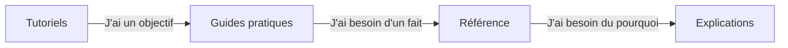

# Amanzi

Amanzi est un outil de conception et de scénarios pour les installations de traitement d'eau potable. Vous dessinez une installation sur un canevas, vous reliez les flux d'eau, et Amanzi calcule la quantité, la qualité, l'énergie, les réactifs et le CO₂ pour un ou plusieurs scénarios du type « et si ». Ce n'est **pas** un système de pilotage d'installation en temps réel.

Utilisez la [démo en ligne](https://demo.amanzi.app) pendant votre apprentissage. Vous n'avez pas besoin d'inventer une analyse de laboratoire pour commencer.

## À qui s'adresse cette documentation

- **Vous débutez** (pas de formation en logiciel, en génie des procédés ou en traitement de l'eau) : commencez par les [Tutoriels](tutorials/index.md). Utilisez le projet de démonstration. Si un mot vous est inconnu, ouvrez les [Explications](explanation/index.md).
- **Utilisateur clé** (vous connaissez déjà l'un de ces domaines) : passez aux [Guides pratiques](how-to/index.md) pour une tâche, à la [Référence](reference/index.md) pour les paramètres et les unités, et aux [Explications](explanation/index.md) pour le fonctionnement des modèles et la littérature qu'ils utilisent.

## Les quatre sections

Ce sont des *types* de pages différents, pas quatre niveaux de difficulté.

- **Tutoriels** — une première prise en main guidée, avec l'installation de démonstration.
- **Guides pratiques** — les étapes d'une tâche que vous voulez déjà faire.
- **Référence** — ce qu'*est* une commande, un flux, une unité ou un nombre.
- **Explications** — à quoi sert Amanzi, ce que signifient les chiffres de l'eau, et la science derrière les modèles.

## Contenu à rédiger

- Description du produit en un paragraphe, en langage courant (canevas, scénarios, cinq familles de résultats).
- Deux portes d'entrée selon le public, avec les liens ci-dessus, courtes.
- Encadré de franchise : outil de conception et de scénarios, pas un SCADA, pas un substitut à une conception agréée.
- Lien vers la démo et vers les versions GitHub.
- La carte des quatre sections (Mermaid, déjà esquissée).
- Indication que cette documentation et l'application sont disponibles en anglais, en néerlandais, en allemand et en français (codes `en`, `nl`, `de`, `fr`, sélecteur de langue). La documentation d'architecture reste en anglais.
