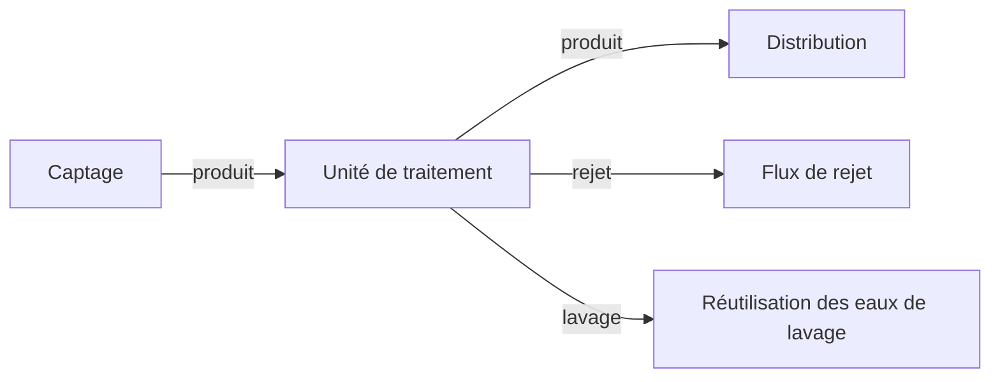

# Flux

Une connexion relie un ancrage d'une unité à un ancrage du même type sur une autre. Il existe trois types.

| Flux | Couleur sur le canevas | Ce qu'il transporte |
|---|---|---|
| Produit | Bleu | Eau qui continue le long de la filière |
| Rejet | Rouge | Eau qui quitte la filière d'eau potable : boues, concentrat, débit du dessableur |
| Lavage | Bleu pointillé | Lavage et autres eaux de lavage |

Chaque unité déclare ses ancrages : côté, sens (entrée ou sortie) et type. Un ancrage qui n'est pas marqué comme optionnel doit être raccordé. La sortie de lavage du réservoir est optionnelle. Un scénario auquel il manque un ancrage obligatoire signale que l'unité n'est pas entièrement reliée. Un scénario sans source, ou sans distribution, ne peut pas être résolu.

Un recyclage ou une répartition peut renvoyer l'eau vers l'amont. La Quantité résout cette boucle comme un seul bilan de matière. La Qualité reparcourt la boucle jusqu'à ce qu'elle se stabilise. La limite est de 100 passages et d'une variation de 0.0001. La raison est dans [Comment Amanzi calcule](../explanation/how-amanzi-calculates.md).

Les ancrages produit se relient aux ancrages produit, rejet à rejet, lavage à lavage. Un ancrage qui a déjà une ligne est laissé tel quel lorsqu'une nouvelle unité est déposée.
