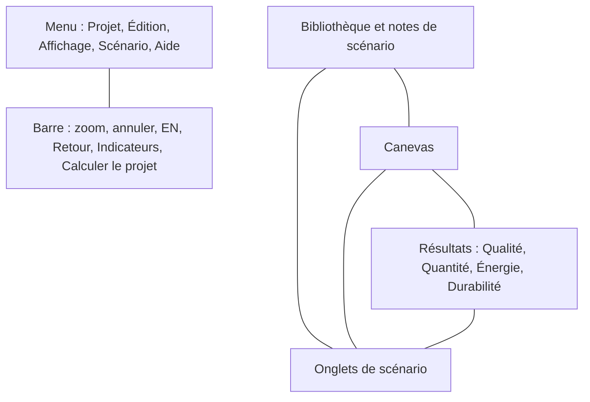

# Interface utilisateur

Noms des régions de la fenêtre Amanzi. La démo s'ouvre avec le menu en anglais lorsque la langue du navigateur est l'anglais.

## Menu

**Projet** contient Nouveau, Ouvrir, Enregistrer, Télécharger, Renommer le projet, Indicateurs et Calculer le projet. **Édition** contient annuler, rétablir et les commandes habituelles du presse-papiers. **Affichage** contient la grille, les barres latérales et le zoom. **Scénario** contient les commandes du scénario ouvert. **Aide** contient Tutoriel, Documentation et À propos d'Amanzi. Documentation ouvre le guide utilisateur dans un nouvel onglet, dans la langue sélectionnée sur le globe (`en`, `nl`, `de` ou `fr`).

La barre sous le menu affiche **Modifications non enregistrées, cliquez ici pour enregistrer.** ou **Toutes les modifications sont enregistrées**.

## Barre supérieure

Le nom du projet est au centre. Un clic ouvre **Changer le nom**.

À gauche : le pourcentage de zoom, le zoom avant et le zoom arrière, annuler, rétablir, sélection ou panoramique, et le globe de langue (**EN**, **NL**, **DE**, **FR**).

À droite : **Retour ?**, **Indicateurs** et **Calculer le projet**. Indicateurs est ce bouton. Ce n'est pas un onglet du panneau de droite.

## Gauche

**Scénario** contient la zone **Notes** du scénario ouvert. **Bibliothèque** est divisée en **Filière principale** et **Flux de rejet**, avec un filtre et une grille ou une liste. **Configuration** affiche le nom de l'unité sélectionnée.

## Canevas

Le dessin. Le panoramique et le zoom déplacent la vue. Les positions des blocs sont une disposition. Ce ne sont pas des coordonnées sur une carte et ce ne sont pas des altitudes.

## Droite

**Qualité**, **Quantité**, **Énergie** et **Durabilité** pour le scénario ouvert. La signification de chaque ligne est dans [Résultats](results.md).

## Bas

Un onglet par scénario. **+** ajoute un scénario vide. La commande d'options d'un onglet duplique, renomme ou supprime ce scénario.

## Boîtes de dialogue

Un double-clic sur une unité ouvre sa vue de conception : un dessin ou un graphique, et les paramètres à gauche. **Calculer le projet** ouvre le rapport. La première visite affiche **Démarrage d'AMANZI...** pendant le chargement du programme de calcul, puis une boîte de dialogue **Tutoriel** avec **Tutoriel terminé**. **À propos d'Amanzi** affiche la mention GPL-3.0, les remerciements (PHREEQC, PhreeqPython, Vue, Element Plus) et une citation BibTeX.
