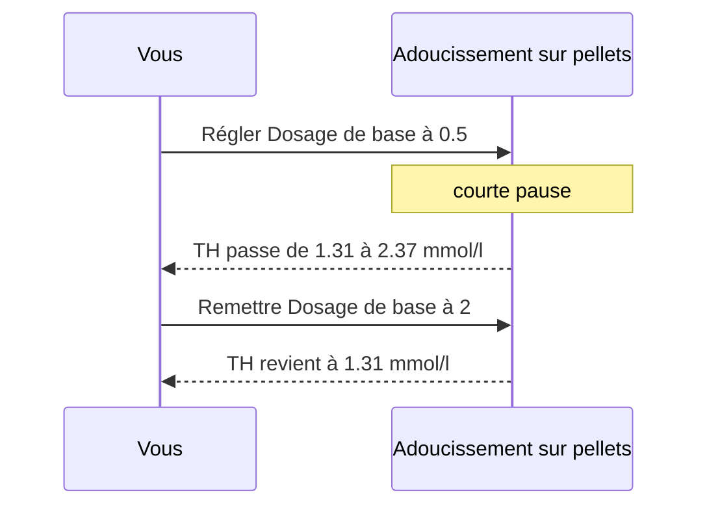

# Modifier un paramètre

Changez un chiffre du projet de démonstration, regardez un résultat bouger, puis remettez le chiffre.

L'unité est **Adoucissement sur pellets**, sur le canevas. Le champ est **Dosage de base**.

## Ouvrir l'unité

Cliquez une fois sur **Adoucissement sur pellets**. Sous **Configuration**, en bas à gauche, le nom de l'unité apparaît.

Double-cliquez sur l'unité. La vue conception s'ouvre. Les réglages sont à gauche. Le dessin est à droite.

## Régler Dosage de base à 0.5

La vue conception s'ouvre avec **Conception** sélectionné. Cliquez sur **Exploitation**. Sous **Dosage**, **Dosage de base** indique 2 mmol/L. Cliquez dans le champ et tapez `0.5`. Une ligne sous le champ dit **Appuyez sur Entrée pour enregistrer**. Appuyez sur Entrée.

Après une courte pause, le dessin se met à jour.

- La dose sur le dessin passe de **2.00 mmol/l** à **0.50 mmol/l**.
- La ligne en tirets sur **Courbe de dosage HH** passe de 2 à 0.5.
- Le cadre vert à droite du dessin, libellé **TH**, passe de **1.31 mmol/l** à **2.37 mmol/l**.

TH est la dureté de l'eau qui quitte cette unité. Le panneau de droite appelle le résultat de l'installation **Dureté**. Ces noms sont expliqués dans [Lire la qualité de l'eau](../explanation/reading-water-quality.md).

Tant que cette fenêtre est ouverte, **Dureté** à droite reste à **1.31 mmol/l**.

<video controls preload="metadata" src="../media/ChangeOneParameter.mp4" style="max-width: 100%; height: auto;" aria-label="Réglez Dosage de base à 0.5, cliquez sur la flèche rouge pour rétablir la valeur par défaut de 1, puis remettez 2">
Réglez Dosage de base à 0.5, cliquez sur la flèche rouge au-dessus du champ pour rétablir la valeur par défaut (1 mmol/L), puis remettez 2. L'anneau marque le curseur. La courbe de dosage et TH bougent à chaque changement.
</video>

La vidéo reste dans cette fenêtre. Elle règle **Dosage de base** à 0.5, clique sur la flèche rouge pour rétablir la valeur par défaut de 1 mmol/L, puis remet **2**, pour que vous voyiez le dessin bouger et revenir. Pour voir le panneau de droite changer, fermez la fenêtre pendant que **Dosage de base** est encore à 0.5.

## Fermer la fenêtre

Fermez la vue conception. Le panneau de droite se met à jour.

**Dureté** indique **2.37 mmol/l**.

Faites défiler le panneau jusqu'à **Durabilité**. **Émissions spécifiques** indique **320** gCO₂-eq/m³. C'était 335. **Émissions totales** indique **3042** ton CO₂-eq/y. C'était 3177.

**Quantité** et **Énergie** gardent les mêmes chiffres. Captage reste à 10.00 Mm³/y. Traitement reste à 0.119 kWh/m³.

La barre du haut passe au jaune : **Modifications non enregistrées, cliquez ici pour enregistrer.** Laissez-la ainsi jusqu'à ce que **Dosage de base** soit de nouveau à 2.

## Remettre 2

La flèche courbe à côté des boutons de zoom reste grise. **Édition → Annuler** reste grisé.

Double-cliquez sur **Adoucissement sur pellets**. Sous **Dosage**, remettez **Dosage de base** à 2 et appuyez sur Entrée. La dose sur le dessin revient à **2.00 mmol/l**, la ligne en tirets revient à 2, et **TH** revient à **1.31 mmol/l**.

Fermez la fenêtre. **Dureté** revient à **1.31 mmol/l**. **Émissions spécifiques** revient à 335 gCO₂-eq/m³. **Émissions totales** revient à 3177 ton CO₂-eq/y.

Les autres champs d'une unité sont dans [Configurer une unité](../how-to/configure-a-unit.md).
