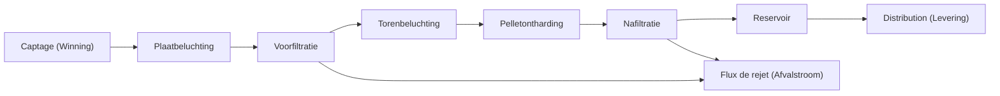

# Votre première installation

Le projet de démonstration est déjà à l'écran. L'eau entre à gauche, traverse les blocs de traitement et sort à droite. Cette page se contente de parcourir cette installation. Laissez chaque valeur telle que vous la trouvez.

## Suivre le dessin

Chaque scénario a besoin d'une source et d'une sortie. Cette démo a déjà les deux. **Captage** représente les puits et sert de source. **Distribution** est la sortie : elle représente la distribution après le traitement.

Le flux produit est indiqué par les flèches bleues. De gauche à droite, les blocs sont **Captage**, **Aération à plateaux**, **Filtration sur sable 1**, **Aération en tour**, **Adoucissement sur pellets**, **Filtration sur sable 2**, **Réservoir** et **Distribution**. Entre le réservoir et la filtration sur sable, des liaisons bleues en pointillés montrent le raccordement de l'eau de lavage des filtres.

**Flux de rejet** se trouve sur la ligne de rejet, sous la filière. Des conduites rouges y arrivent depuis les deux filtrations sur sable. Les conduites de rejet sont rouges.

<video controls preload="metadata" src="../media/WalkDemoPlant.mp4" style="max-width: 100%; height: auto;" aria-label="Suivez les conduites bleues de Winning à Levering, faites une pause sur Afvalstroom, puis sélectionnez Voorfiltratie">
Le curseur suit les conduites bleues de Winning à Levering, fait une pause sur Afvalstroom pour bien montrer la conduite de rejet rouge, puis sélectionne Voorfiltratie.
</video>

Une unité rouge n'est pas entièrement reliée. La correction est dans [Ajouter et relier des unités](../how-to/add-and-connect-units.md).

## Le résultat à droite

Le panneau de droite est déjà rempli avant que vous cliquiez sur un bloc. C'est le résultat de toute l'installation. Quatre titres :

**Qualité** liste ce que contient l'eau : pH, EGV, O₂, HCO₃, TAC, Dureté, TDS, TACC₉₀, AggCO₂, SI, Fe, Mn, NH₄, Na et Cl.

**Quantité** liste Captage, Distribution et Pertes. Captage indique 10.00 Mm³/y.

**Énergie** liste Traitement, Distribution et Total.

**Durabilité** est le dernier titre. Il liste Émissions spécifiques et Émissions totales.

## Sélectionner un bloc

Cliquez une fois sur **Adoucissement sur pellets**. Un contour bleu montre que le bloc est sélectionné. En bas à gauche, **Configuration** affiche le **Nom** et un bouton **Modifier les paramètres du modèle**. Ce bouton, ou un double-clic sur le bloc, ouvre la vue conception détaillée de ce modèle.
Vous pouvez y [modifier tous les paramètres de conception](change-one-thing.md).
