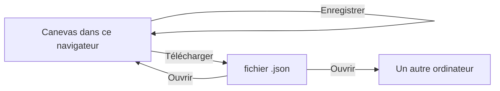

# Enregistrer votre travail

Le projet vit dans ce navigateur. Enregistrez-le ici, téléchargez un fichier `.json`, puis rouvrez ce fichier.

**Enregistrer** garde le canevas dans ce navigateur. **Télécharger** écrit le fichier `.json`. **Ouvrir** lit ce fichier sur ce canevas, ou sur un autre ordinateur.

## Enregistrer dans ce navigateur

Modifiez une note sous **Scénario**. Le titre gagne un astérisque, et la barre passe au jaune : **Modifications non enregistrées, cliquez ici pour enregistrer.**

Cliquez sur cette barre, ou choisissez **Projet → Enregistrer**. Sur un Mac, le raccourci est ⌘S. Ailleurs, c'est Ctrl+S. La barre doit alors indiquer **Toutes les modifications sont enregistrées**.

Quittez la page et revenez. Le projet enregistré est toujours dans ce navigateur.
Pour partager votre projet, l'enregistrer ne suffit pas : vous devez le télécharger.

<video controls preload="metadata" src="../media/SaveInBrowser.mp4" style="max-width: 100%; height: auto;" aria-label="Modifiez une note de scénario et enregistrez jusqu'à ce que la barre indique Toutes les modifications sont enregistrées">
Saisissez une note sous Scénario, ouvrez Projet et cliquez sur Enregistrer pour que la barre passe de Modifications non enregistrées à Toutes les modifications sont enregistrées.
</video>

## Télécharger un fichier

Cliquez sur le nom du projet, ou choisissez **Projet → Renommer le projet**. Le titre de la fenêtre est **Changer le nom**. Saisissez un nom et cliquez sur **Enregistrer**.

**Projet → Télécharger** écrit un fichier `.json` qui porte le titre. **North plant** devient `North plant.json`.

Un changement de nom seul ne fait pas passer la barre au jaune. **Télécharger** n'efface pas tout seul **Modifications non enregistrées**. **Enregistrer** le fait, et ce navigateur conserve le nouveau nom.

Le détail du renommage, et de **Projet → Nouveau...**, est dans [Enregistrer, charger, télécharger](../how-to/save-load-download.md).

<video controls preload="metadata" src="../media/DownloadJson.mp4" style="max-width: 100%; height: auto;" aria-label="Ouvrez le menu Projet et téléchargez le projet en fichier JSON">
Ouvrez Projet et cliquez sur Télécharger pour écrire le fichier .json.
</video>

## Ouvrir le fichier

**Projet → Ouvrir** remplace le projet à l'écran. Amanzi ne demande pas confirmation. La fenêtre de fichier est celle du système, elle n'est donc pas dans la vidéo. Dans la vidéo, le canevas commence vide, et **Ouvrir** ramène **North plant**, notes comprises.

Vous pouvez envoyer le `.json` par e-mail. Un collègue ouvre le même fichier avec **Projet → Ouvrir**.

<video controls preload="metadata" src="../media/OpenProject.mp4" style="max-width: 100%; height: auto;" aria-label="Ouvrez un fichier JSON depuis un projet vide et ramenez North plant avec ses notes">
Depuis un nouveau projet vide, cliquez sur Ouvrir : le fichier revient sous le nom North plant, avec ses notes.
</video>

## Un fichier plus ancien

Un fichier plus ancien peut afficher **Fichier de projet mis à jour**. Ce que cette notice liste est dans [Enregistrer, charger, télécharger](../how-to/save-load-download.md).
