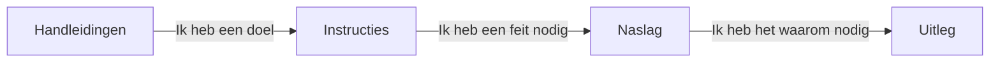

# Amanzi

Amanzi is een ontwerp- en scenariotool voor drinkwaterzuiveringen. Je tekent een installatie op een canvas, verbindt waterstromen, en Amanzi berekent hoeveelheid, kwaliteit, energie, chemicaliën en CO₂ voor een of meer what-if-ontwerpen. Het is **geen** live plantcontroller.

Gebruik de [gehoste demo](https://demo.amanzi.app) terwijl je leert. Je hoeft nooit zelf een laboratoriumanalyse te verzinnen om te beginnen.

## Voor wie deze documentatie is

- **Nieuw hier** (geen achtergrond in software, procestechniek of waterbehandeling): begin bij [Handleidingen](tutorials/index.md). Gebruik het demoproject. Als een woord onbekend lijkt, open [Uitleg](explanation/index.md).
- **Sleutelgebruiker** (je kent al een van die domeinen): ga naar [Instructies](how-to/index.md) voor een taak, [Naslag](reference/index.md) voor parameters en eenheden, en [Uitleg](explanation/index.md) voor hoe de modellen werken en welke literatuur ze gebruiken.

## De vier secties

Dit zijn verschillende *soorten* pagina’s, geen vier moeilijkheidsniveaus.

- **Handleidingen** — een begeleidde eerste ervaring met de demo-installatie.
- **Instructies** — stappen voor een klus die je al wilt doen.
- **Naslag** — wat een bediening, stroom, unit of getal *is*.
- **Uitleg** — waar Amanzi voor is, wat de watercijfers betekenen, en de wetenschap achter de modellen.

## Inhoud om te schrijven

- Productbeschrijving van één alinea in alledaagse taal (canvas, scenario’s, vijf resultaatfamilies).
- Twee publieksingangen met de links hierboven, kort gehouden.
- Eerlijkheidskader: ontwerp-/scenariotool, geen SCADA, geen vervanging voor een vergund ontwerp.
- Link naar de demo en naar GitHub-releases.
- De vier-sectiekaart (Mermaid, al opgezet).
- Verwijzing dat deze documentatie en de app beschikbaar zijn in het Engels, Nederlands en Duits (taalkiezer). Architectuurdocumentatie blijft Engels.
